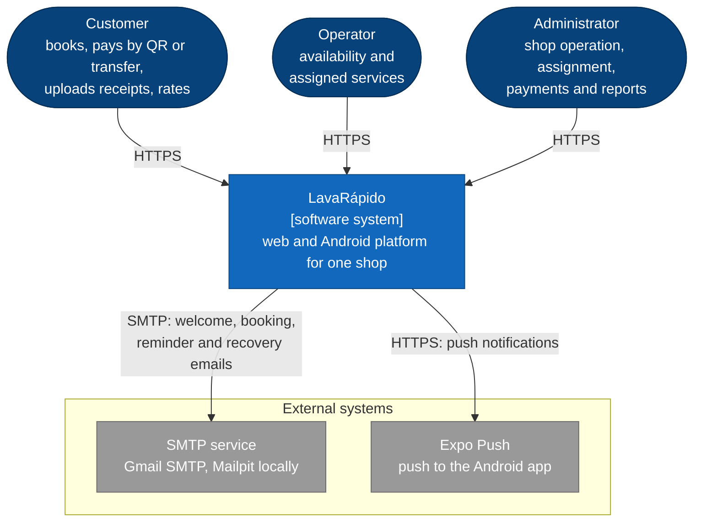
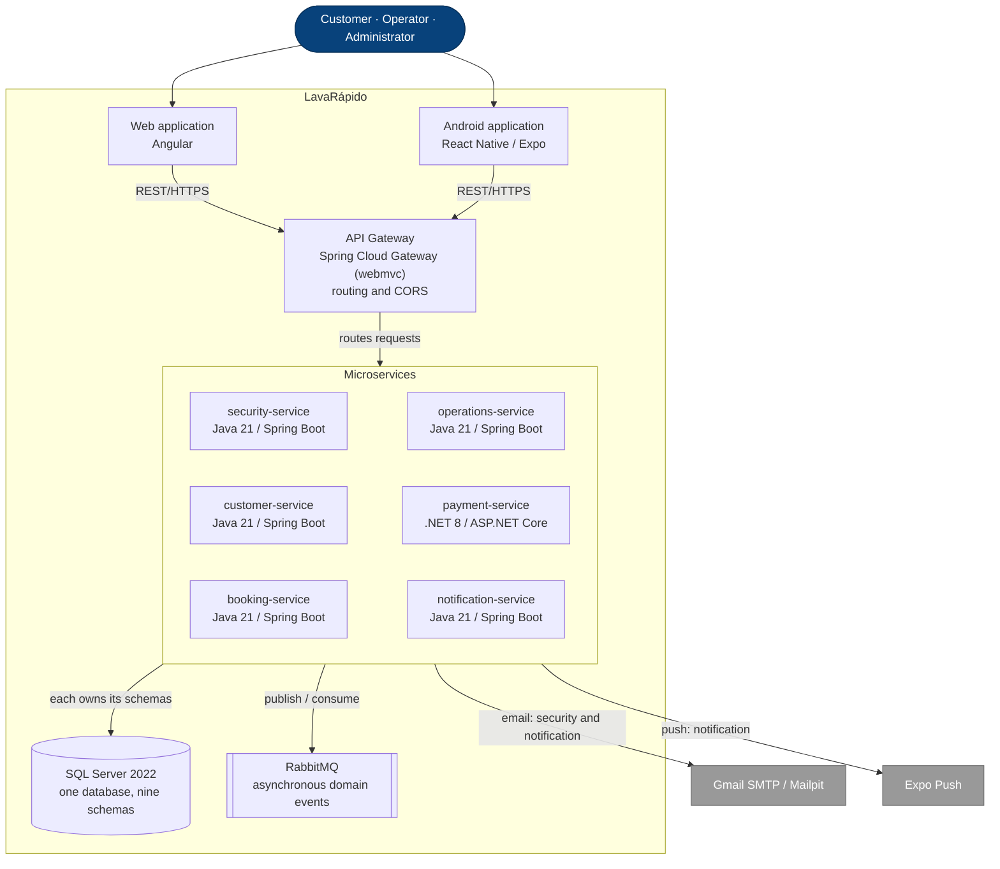

# System Architecture Overview

**Last updated:** 2026-10-20 (checked against the code)

## 1. Architectural style

LavaRápido uses a **microservice architecture with logical data ownership**. The backend is divided into six domain services. The services share one physical SQL Server database in the current academic environment, but each schema has one owning service and cross-service foreign keys are not used.

The current decomposition is:

| Service | Schemas | Responsibility |
|---|---|---|
| `security-service` | `security`, `audit` | People, accounts, roles, sessions, password recovery, user preferences and audit data |
| `customer-service` | `customer` | Customers, vehicle types, customer vehicles and the display copy of loyalty points |
| `booking-service` | `catalog`, `booking` | Wash services, prices, establishment, hours, exceptions, bays and bookings |
| `operations-service` | `execution` | Operators, availability, absences, assignment, execution and service ratings |
| `payment-service` | `promotion`, `payment` | Promotions, payment accounts, payments, receipts and loyalty ledger |
| `notification-service` | `notification` | In-app notifications, push, email, booking reminders and staff alerts |

The API Gateway is the single external entry point. It is infrastructure and is not counted as a seventh domain service.

### Implementation status (2026-10-20)

| Component | Port | State |
|---|---|---|
| `api-gateway` | 8080 | Built: routes the six services, CORS; JWT checked by each service |
| `security-service` | 3001 | Built |
| `customer-service` | 3002 | Built |
| `booking-service` | 3003 | Built (catalog, schedule, bays, availability, bookings) |
| `operations-service` | 3004 | Built (operators, shifts, absences, automatic and manual assignment, execution, ratings, inspection report) |
| `payment-service` | 3005 | Built, .NET 8 (payment accounts with QR, payments with receipt and admin review, in-person payments, refunds, promotions, loyalty points and their events); in Docker Compose with `payment-migrate` for its tables |
| `notification-service` | 3006 | Built (inbox, push tokens, email, booking reminders, alerts to the admins, app-update notice) |

The web reaches all six services through the gateway; the screens still on local data are listed in
`12-ux-ui/navigation-map.md`.

## 2. Data ownership

The system has one physical SQL Server database with nine schemas and 57 tables. Logical ownership is enforced by service boundaries and application validation:

```text
SQL Server database
│
├── security-service
│   ├── security
│   └── audit
│
├── customer-service
│   └── customer
│
├── booking-service
│   ├── catalog
│   └── booking
│
├── operations-service
│   └── execution
│
├── payment-service
│   ├── promotion
│   └── payment
│
└── notification-service
    └── notification
```

There are no foreign keys between schemas owned by different services. The current data model documents 26 cross-service references as plain identifiers (list in `06-data/models.md`). Inside a service, normal relational constraints can be used; for example, `booking.booking_service.service_price_id` can reference `catalog.service_price` because both schemas belong to `booking-service`.

## 3. C4 Level 1 — System context



The payment flow has no external gateway. The customer pays from their own banking application and the platform only receives the uploaded receipt. No card data is collected or transmitted.

## 4. C4 Level 2 — Containers



| Container | Responsibility | Schemas | Messaging |
|---|---|---|---|
| security-service | Identity, roles, sessions, preferences and audit | `security`, `audit` | Publishes `security.user_registered` |
| customer-service | Customers, vehicles and loyalty display copy | `customer` | Consumes `security.user_registered` |
| booking-service | Catalog, prices, shop schedule and bookings | `catalog`, `booking` | Publishes booking events |
| operations-service | Operators, assignment, execution and ratings | `execution` | Publishes execution events, consumes `booking.confirmed` |
| payment-service | Payments, receipts, promotions and loyalty ledger | `payment`, `promotion` | Publishes payment, coupon and loyalty events |
| notification-service | In-app notifications, push, email and booking reminders | `notification` | Consumes the notification events |

| REST call between services | Credential |
|---|---|
| booking → customer: validates vehicles | User token |
| customer → security: reads the user's profile | User token |
| notification → security: reads email and name | Internal key |
| operations → booking: reads bookings, moves their status | User token or internal key |
| operations → security: reads operator accounts and contacts | Admin token or internal key |
| payment → booking: reads booking total and status | User token |

## 5. Communication

### Synchronous

REST is used when a caller needs an answer before continuing. Examples include validating a customer vehicle before creating a booking, validating a current service price, checking an operator's availability and validating a booking before creating a payment.

Service-to-service calls do not pass through the API Gateway. Today there are six pairs:

| Caller → callee | Why | Credential |
|---|---|---|
| booking → customer | Validate the vehicle and its type before booking; plates for the admin list | The user's JWT, forwarded |
| customer → security | Create the customer profile on first use from the user's data | The user's JWT, forwarded |
| notification → security | Email and name of the user to email a notification (`/internal/v1/users/{id}/contact`) | `X-Internal-Key` (no user is involved; ADR-011 §8) |
| operations → booking | Read bookings to assign; move them to `IN_PROGRESS` / `COMPLETED`; check the client's booking before rating | The user's JWT, forwarded; `X-Internal-Key` on `/internal/v1/bookings` for the automatic assignment (no user involved) |
| operations → security | Operator accounts and names (`/admin/users?role=OPERATOR`); whether an operator's account is still active during the automatic assignment (`/internal/v1/users/{id}/contact`) | The admin's JWT, forwarded; `X-Internal-Key` for the internal route |
| payment → booking | Booking total, status and owner before reporting or approving a payment | The user's JWT, forwarded |

booking → customer, operations → booking/security and payment → booking forward the caller's `X-Correlation-Id`; customer → security, notification → security and the RabbitMQ events do not yet (gap in `13-operations/observability.md`).

The script that publishes a new APK (`lavarapido-infra/deploy/publish-apk.sh`) also calls notification-service on `/internal/v1/notifications/app-update` with `X-Internal-Key`, from inside the Docker network.

### Asynchronous

RabbitMQ (topic exchange `carwash.events`) is used for work that can happen after the original transaction. Built today:

| Event | Publisher | Consumers |
|---|---|---|
| `security.user_registered` | security | customer (profile), notification (welcome) |
| `booking.confirmed` (created or rescheduled), `booking.cancelled` | booking | notification (inbox, email, reminders) |
| `booking.confirmed` | booking | operations (automatic operator assignment) |
| `execution.operator_assigned`, `execution.service_started`, `execution.service_completed`, `execution.inspection_shared` | operations | notification (operator and client; started and completed also cancel the reminders) |
| `payment.confirmed`, `payment.rejected`, `payment.refunded`, `payment.promotion_redeemed`, `payment.loyalty_points_earned` | payment | notification (client) |

customer-service raises `CustomerProvisioned` and vehicle events in its domain but only logs them (no consumer needs them yet); security-service does the same with its email, password and deactivation events. Diagram of every link: `08-uml/diagrams/source/c2-containers.md`. Event names and payloads → `09-microservices/services/*/events.md`.

Events are published after the database transaction commits. The current architecture accepts the risk of a failure between commit and publish; an Outbox implementation is **not adopted yet**.

## 6. Main flow

```text
Customer
   │
   ▼
Web / Android
   │ REST
   ▼
API Gateway
   │
   ├── security-service
   ├── customer-service
   ├── booking-service ───── REST ─── customer-service
   │        │                         catalog data
   │        └────────────── RabbitMQ ──► notification-service
   │
   ├── operations-service ── REST ─── booking-service (read, move status)
   │        │
   │        └────────────── RabbitMQ ──► notification-service
   │
   └── payment-service ───── REST ─── booking-service (total, status)
             │
             └────────────── RabbitMQ ──► notification-service
```

## 7. Architectural constraints

- One establishment is in scope for the MVP.
- The six services are the current backend decomposition.
- `api-gateway` is infrastructure.
- SQL Server is the only application database engine in this version.
- No service directly queries another service's tables as part of its business logic.
- No cross-service foreign key exists.
- Payment verification is manual and does not use Wompi or another payment gateway.
- Assignment requires operator availability; the automatic rule prefers the operator the customer chose, then the one with the fewest bookings that day, then the lowest id (ADR-014).

## 8. References

- Current service/data ownership → `06-data/models.md`
- Service decomposition → `decisions/records/ADR-009-service-decomposition-revised.md`
- Database strategy → `decisions/records/ADR-003-database-strategy.md`
- Communication → `decisions/records/ADR-004-service-communication.md`
- Gateway → `decisions/records/ADR-005-api-gateway.md`
- Authentication → `decisions/records/ADR-006-authentication-and-authorization.md`
- Internal service structure → `decisions/records/ADR-007-internal-service-architecture.md`
- Payment verification → `decisions/records/ADR-008-payment-verification.md`
