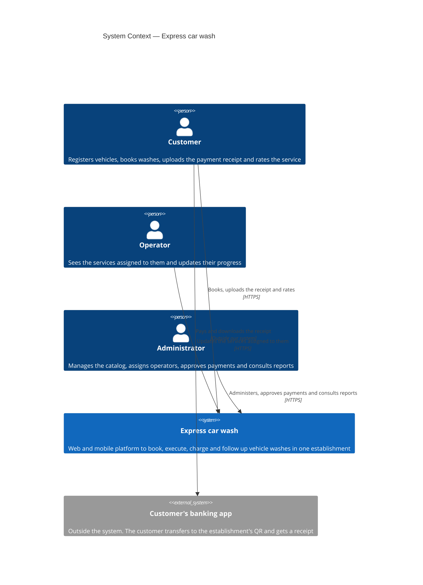

# System Architecture Overview

> Express car wash — the technical picture of the system: how it is organised, which
> components exist, how they talk to each other, and which decisions this organisation
> comes from. Every decision summarised here is argued in detail in `decisions/records/`.

**Last updated:** 2026-09-10

---

## 1. Architectural style

The backend is built as **microservices, one service per database schema**, communicating
over REST and RabbitMQ events, with the web and mobile clients reaching them through a
single API Gateway.

Three things make this different from the textbook description, and all three are
deliberate:

- **One service per schema.** The data model in `06-data` defines ten schemas and states
  that each one is an independent service. There is not a single foreign key crossing
  between schemas, so the boundary is enforced by the database itself.
- **The ten services share one SQL Server database.** There is no database per service.
- **There are no external systems.** Payment is not delegated to a gateway: the customer
  pays outside the system and uploads a receipt that the administrator verifies (ADR-008).

Reference decisions: [ADR-002](decisions/records/ADR-002-architectural-style-and-service-decomposition.md),
[ADR-003](decisions/records/ADR-003-database-strategy.md) and
[ADR-008](decisions/records/ADR-008-payment-verification.md).

---

## 2. C4 — Level 1: System context

**The system has no integration with any external system.** The banking app appears in the
diagram because it is part of the payment story, but there is no connection between it and
us: the money never passes through the platform, and neither does any card data (RF-016).

---

## 3. C4 — Level 2: Containers

```mermaid
C4Container
    title Container Diagram — Express car wash

    Person(customer, "Customer")
    Person(operator, "Operator")
    Person(admin, "Administrator")

    System_Boundary(carwash, "Express car wash") {
        Container(web, "Web application", "Angular", "Interface for customers and administrators")
        Container(mobile, "Mobile application", "React Native (Android)", "Interface for customers and operators")

        Container(gateway, "API Gateway", "Spring Cloud Gateway", "Single entry point. Routes and rejects requests without a valid JWT")

        Container(security, "security-service", "Java 21 / Spring Boot", "People, accounts, roles, sessions, password reset")
        Container(settings, "settings-service", "Java 21 / Spring Boot", "Establishment data and user preferences")
        Container(customersvc, "customer-service", "Java 21 / Spring Boot", "Customers, vehicles and loyalty points")
        Container(catalog, "catalog-service", "Java 21 / Spring Boot", "Wash services, categories and prices")
        Container(reserva, "reserva-service", "Java 21 / Spring Boot", "Business hours, bays and bookings")
        Container(execution, "execution-service", "Java 21 / Spring Boot", "Operators, availability, execution and ratings")
        Container(promotion, "promotion-service", "Java 21 / Spring Boot", "Promotions, eligibility and discounts applied")
        Container(payment, "payment-service", "Java 21 / Spring Boot", "Payment accounts, payments and receipt verification")
        Container(notification, "notification-service", "Java 21 / Spring Boot", "Notices with read state, built from events")
        Container(audit, "audit-service", "Java 21 / Spring Boot", "Queries over the change log written by database triggers")

        ContainerDb(db, "Database", "SQL Server", "One database, ten schemas, 43 tables. Each service reaches only its own schema")
        ContainerQueue(broker, "Event broker", "RabbitMQ", "Topic exchange carwash.events, one queue per consumer, dead letter queues")
    }

    Rel(customer, web, "Uses", "HTTPS")
    Rel(admin, web, "Uses", "HTTPS")
    Rel(customer, mobile, "Uses", "HTTPS")
    Rel(operator, mobile, "Uses", "HTTPS")

    Rel(web, gateway, "REST calls", "HTTPS/JSON")
    Rel(mobile, gateway, "REST calls", "HTTPS/JSON")

    Rel(gateway, security, "Routes /api/security", "REST")
    Rel(gateway, settings, "Routes /api/settings", "REST")
    Rel(gateway, customersvc, "Routes /api/customers", "REST")
    Rel(gateway, catalog, "Routes /api/catalog", "REST")
    Rel(gateway, reserva, "Routes /api/reservas", "REST")
    Rel(gateway, execution, "Routes /api/execution", "REST")
    Rel(gateway, promotion, "Routes /api/promotions", "REST")
    Rel(gateway, payment, "Routes /api/payments", "REST")
    Rel(gateway, notification, "Routes /api/notifications", "REST")
    Rel(gateway, audit, "Routes /api/audit", "REST")

    Rel(reserva, customersvc, "Validates vehicle and owner", "REST")
    Rel(reserva, catalog, "Reads the current price", "REST")
    Rel(reserva, execution, "Operator availability", "REST")
    Rel(execution, security, "Validates the operator account", "REST")
    Rel(promotion, reserva, "Validates the booking", "REST")
    Rel(promotion, customersvc, "Checks eligibility", "REST")
    Rel(payment, reserva, "Reads the booking being paid", "REST")

    Rel(reserva, broker, "Publishes reserva.*", "AMQP")
    Rel(execution, broker, "Publishes execution.* / consumes reserva.*", "AMQP")
    Rel(payment, broker, "Publishes payment.*", "AMQP")
    Rel(broker, notification, "Delivers the events it reacts to", "AMQP")
    Rel(broker, customersvc, "Delivers payment.approved for loyalty points", "AMQP")
    Rel(broker, reserva, "Delivers execution.service_started / finished", "AMQP")

    Rel(security, db, "security schema", "JDBC")
    Rel(settings, db, "settings schema", "JDBC")
    Rel(customersvc, db, "customer schema", "JDBC")
    Rel(catalog, db, "catalog schema", "JDBC")
    Rel(reserva, db, "reserva schema", "JDBC")
    Rel(execution, db, "execution schema", "JDBC")
    Rel(promotion, db, "promotion schema", "JDBC")
    Rel(payment, db, "payment schema", "JDBC")
    Rel(notification, db, "notification schema", "JDBC")
    Rel(audit, db, "audit schema", "JDBC")
```

Three things to read carefully in this diagram:

- Every service reaches the **same database**, but only its own schema. The separation is
  enforced with one database user per service and zero cross-schema foreign keys (ADR-003).
- **The seven REST arrows between services** are validations of references the database no
  longer protects. They come one by one from section 16 of `06-data` (ADR-004).
- The `audit` schema is written by **database triggers**, not by the services. Nobody
  publishes an audit event.

---

## 4. Component catalog

| # | Component | Schema | Tables | Responsibility | Requirements |
|---|-----------|--------|--------|----------------|--------------|
| 1 | `api-gateway` | — | — | Entry point, routing, JWT verification, CORS, correlation id, receipt uploads | RNF-004.1 |
| 2 | `security-service` | `security` | 8 | People, accounts, roles, permissions, sessions, password reset | RF-001 to RF-004b |
| 3 | `audit-service` | `audit` | 1 | Queries over the change log written by triggers | Supports RF-023 |
| 4 | `settings-service` | `settings` | 2 | Establishment data, theme and language per user | RF-019, RF-020 |
| 5 | `customer-service` | `customer` | 5 | Customers, vehicles, vehicle types, loyalty points | RF-026 |
| 6 | `catalog-service` | `catalog` | 3 | Services, categories and prices per vehicle type | Supports RF-005 |
| 7 | `reserva-service` | `reserva` | 7 | Business hours, exceptions, bays, bookings and their service lines | RF-005 to RF-007 |
| 8 | `execution-service` | `execution` | 5 | Operators, availability, absences, execution and ratings | RF-008 to RF-012b, RF-022 |
| 9 | `promotion-service` | `promotion` | 5 | Promotions, eligibility, discounts applied to a booking | RF-024, RF-025 |
| 10 | `payment-service` | `payment` | 5 | Payment accounts, payments, receipts and their verification | RF-013 to RF-016 |
| 11 | `notification-service` | `notification` | 2 | Notification types and notices with read state | RF-018 |

Ports, container names and environment variables are defined in `deployment.md`.

RF-017 (dashboard by role) is resolved in the clients. RF-021 and RF-023 refer to branches
and per-branch reports, and have to be rewritten in `04-requirements`: the system has one
establishment with bays.

---

## 5. Architectural principles

The rules we check a decision against before making it.

### P1: One service, one schema
A service reads and writes only its own schema. To reach another domain's data it calls the
owning service or reacts to its events. The database user of each service enforces it.

### P2: What the database can guarantee, the database guarantees
Inside a schema, integrity is protected with foreign keys, `CHECK` constraints, filtered
indexes and triggers — not with application code that somebody might forget. What crosses
schemas has no foreign key, so **there** the application validates, and it validates before
writing.

### P3: Business rules live in the domain
Each service is organised with hexagonal architecture. Rules live in the aggregate, not in
a controller, and the `domain` package imports neither Spring nor JPA (ADR-007).

### P4: Ask synchronously, react asynchronously
If the caller cannot answer the user without the result, it is a REST call. If its work is
already done and something else has to react, it is an event. We do not create events that
have no consumer.

### P5: Only technology we can run and explain
Every component in the diagram has to run on the team's machines and be defended in a
review session. That is why there is no Redis, no Kafka, no service discovery, no tracing
stack and no payment gateway.

---

## 6. Adopted architectural patterns

| Pattern | Adopted | Reason / reference |
|---------|---------|--------------------|
| API Gateway | Yes | Single entry point for two clients — ADR-005 |
| Hexagonal architecture | Yes | Gives the domain rules a place to live — ADR-007 |
| Shared database with a schema per service | Yes | ADR-003 |
| Publish/subscribe with a topic exchange | Yes | ADR-004 |
| Dead Letter Queue | Yes | A failed event is not lost silently — ADR-004 |
| Retry with backoff | Yes | Limited attempts before the dead letter queue — ADR-004 |
| Optimistic locking (`row_version`) | Yes | Two administrators editing the same row — ADR-003 |
| Logical deletion | Yes | Nothing is physically deleted — ADR-003 |
| Audit log written by triggers | Yes | One `audit.audit_log` instead of a history table per entity — ADR-003 |
| Idempotent consumer | **Pending** | Required by at-least-once delivery, but the data model has no table for it — ADR-004 |
| Database per Service | No | One database with a schema per service — ADR-003 |
| External payment gateway | No | Payment is verified in-house — ADR-008 |
| Saga | No | No distributed transaction is attempted; consistency between services is validated before writing |
| Outbox | No | Evaluated and postponed; events are published after the commit — ADR-004 |
| Circuit Breaker | No | No external traffic and a handful of internal calls — ADR-004 |
| CQRS | No | The read and write models are practically the same |
| Event Sourcing | No | `audit_log` already covers the change history |
| Backend for Frontend | No | Web and mobile consume the same API |
| Service Discovery | No | Fixed addresses inside the Docker environment |

---

## 7. Cross-cutting concerns

| Concern | Solution | Where |
|---------|----------|-------|
| Authentication | JWT verified at the gateway and in every service | ADR-006 |
| Authorization | Role at the endpoint, ownership rules in the service | ADR-006 |
| Passwords and reset tokens | BCrypt; the reset token is stored hashed | RNF-004.3, ADR-006 |
| Audit block | `created_at/by`, `updated_at/by`, `deleted_at/by`, `row_version` on every domain table | ADR-003 |
| Deletion | Logical, never physical | ADR-003 |
| Change history | `audit.audit_log`, written by a trigger per table | ADR-003 |
| Dates | `DATETIME2(3)` in UTC; the clients convert to local time | ADR-003 |
| Logging | Plain logs to standard output, read with `docker logs` | RNF-005 |
| Traceability | Correlation id generated at the gateway and carried in the event envelope | ADR-005 |
| Health checks | Health endpoint per service with Spring Boot Actuator — proposed | `deployment.md` |
| Configuration and secrets | Environment variables, never in the repository | RNF-004.7 |
| Migrations | One ordered Liquibase changelog for the whole database, applied before the services start; forward-only | RNF-006.3, ADR-003 |
| Rate limiting | Not adopted; no public exposure | ADR-005 |

Detail in `cross-cutting.md`.

Distributed tracing, Prometheus metrics and alerting are **not** part of this project:
`04-requirements/non-functional.md` drops them explicitly.

---

## 8. Registered architectural technical debt

| ID | Description | Impact | Priority |
|----|-------------|--------|----------|
| AT-001 | Delivery is at-least-once but there is no table to record processed events, so a repeated event could duplicate an assignment or a loyalty accrual | Duplicated data | P1 |
| AT-002 | Where receipt images are stored is not decided | Blocks RF-013 and the local environment | P1 |
| AT-003 | RNF-003 requires a payment and its booking to be written in one transaction, which is impossible with two services and two schemas | The requirement cannot be met as written | P1 |
| AT-004 | RF-004b does not define how many failed attempts trigger the lock, or for how long | The feature cannot be built | P1 |
| AT-005 | `01`, `02` and `04` still describe branches and a payment gateway | The documentation contradicts itself | P1 |
| AT-006 | The JWT is signed with HS256 and every service holds the secret | High if deployed, low while local | P2 |
| AT-007 | A JWT cannot be revoked: logout or lockout takes effect up to an hour later | Limited security window, accepted | P3 |
| AT-008 | Dead letter queues are reviewed by hand in the RabbitMQ console | A failure can go unnoticed | P3 |
| AT-009 | `09-microservices` still describes the scaffold services with Kong, Redis and PostgreSQL | Misleading documentation | P3 |

---

## 9. Planned evolution

Not commitments — what we already know we would change if the project continued past the
academic delivery.

| Change | Motivation |
|--------|------------|
| JWT signed with RS256 | Only `security-service` should be able to issue tokens (AT-006) |
| Outbox pattern for publishing events | Removes the window where a committed change never publishes its event |
| Rate limiting at the gateway | Needed as soon as there is public exposure |
| Payment gateway integration | Removes the manual approval step, once there is a public URL (ADR-008) |
| Merge `audit-service` and `settings-service` | If eleven applications prove to be too many for the team (ADR-002) |

---

## 10. Correlations

- Schemas, tables, constraints and triggers → `06-data/MODELO-DE-DATOS.md`
- Cross-service references that the application must validate → `06-data`, section 16
- Bounded Contexts and domain rules → `02-domain/`
- Functional and non-functional requirements → `04-requirements/`
- Full decisions → `05-architecture/decisions/records/`
- Internal structure of a service → `05-architecture/hexagonal-architecture.md`
- Patterns and when to use them → `05-architecture/pattern-guide.md`
- Local environment → `05-architecture/deployment.md`
- Per-service detail → `09-microservices/`