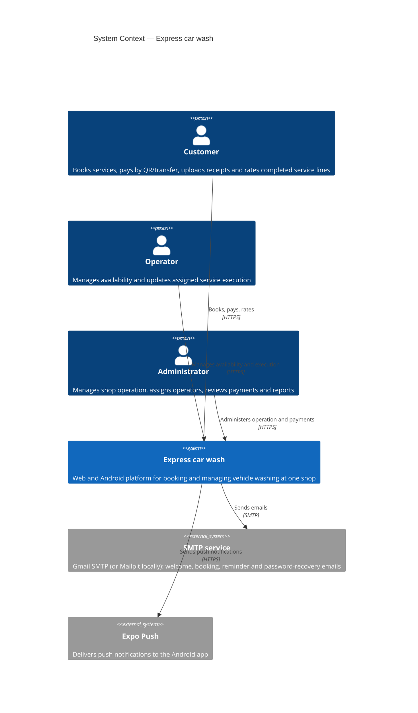

# System Architecture Overview

**Last updated:** 2026-10-04

## 1. Architectural style

Express car wash uses a **microservice architecture with logical data ownership**. The backend is divided into six domain services. The services share one physical SQL Server database in the current academic environment, but each schema has one owning service and cross-service foreign keys are not used.

The current decomposition is:

| Service | Schemas | Responsibility |
|---|---|---|
| `security-service` | `security`, `audit` | People, accounts, roles, sessions, password recovery, user preferences and audit data |
| `customer-service` | `customer` | Customers, vehicle types, customer vehicles and the display copy of loyalty points |
| `booking-service` | `catalog`, `booking` | Wash services, prices, establishment, hours, exceptions, bays and bookings |
| `operations-service` | `execution` | Operators, availability, absences, assignment, execution and service ratings |
| `payment-service` | `promotion`, `payment` | Promotions, payment accounts, payments, receipts and loyalty ledger |
| `notification-service` | `notification` | In-app notifications and read state |

The API Gateway is the single external entry point. It is infrastructure and is not counted as a seventh domain service.

### Implementation status (2026-10-04)

| Component | Port | State |
|---|---|---|
| `api-gateway` | 8080 | Built: routes the four built services, CORS; JWT checked by each service |
| `security-service` | 3001 | Built |
| `customer-service` | 3002 | Built |
| `booking-service` | 3003 | Built (catalog, schedule, bays, availability, bookings) |
| `operations-service` | — | In development by another team member; not routed yet |
| `payment-service` | — | Incomplete; not routed yet |
| `notification-service` | 3006 | Built (inbox, push tokens, email, booking reminders) |

Screens whose service is not built still use local data in the web (see
`12-ux-ui/navigation-map.md`).

## 2. Data ownership

The system has one physical SQL Server database with nine schemas and 47 tables. Logical ownership is enforced by service boundaries and application validation:

```text
SQL Server database
│
├── security-service
│   ├── security
│   └── audit
│
├── customer-service
│   └── customer
│
├── booking-service
│   ├── catalog
│   └── booking
│
├── operations-service
│   └── execution
│
├── payment-service
│   ├── promotion
│   └── payment
│
└── notification-service
    └── notification
```

There are no foreign keys between schemas owned by different services. The current data model documents 21 cross-service references as indexed identifiers. Inside a service, normal relational constraints can be used; for example, `booking.booking_service.service_price_id` can reference `catalog.service_price` because both schemas belong to `booking-service`.

## 3. C4 Level 1 — System context



The payment flow has no external gateway. The customer pays from their own banking application and the platform only receives the uploaded receipt. No card data is collected or transmitted.

## 4. C4 Level 2 — Containers

```mermaid
C4Container
    title Container Diagram — Express car wash

    Person(customer, "Customer")
    Person(operator, "Operator")
    Person(admin, "Administrator")

    System_Boundary(system, "Express car wash") {
        Container(web, "Web application", "Angular", "Customer and administrator interface")
        Container(mobile, "Android application", "React Native", "Customer and operator mobile interface")
        Container(gateway, "API Gateway", "Spring Cloud Gateway (webmvc)", "External entry point, routing and CORS")
        Container(security, "security-service", "Java 21 / Spring Boot", "Identity, roles, sessions, preferences and audit")
        Container(customerSvc, "customer-service", "Java 21 / Spring Boot", "Customers, vehicles and loyalty display copy")
        Container(booking, "booking-service", "Java 21 / Spring Boot", "Catalog, prices, shop schedule and bookings")
        Container(operations, "operations-service", "Java 21 / Spring Boot", "Operators, assignment, execution and ratings")
        Container(payment, "payment-service", "Java 21 / Spring Boot", "Payments, receipts, promotions and loyalty ledger")
        Container(notification, "notification-service", "Java 21 / Spring Boot", "In-app notifications, push, email and booking reminders")
        ContainerDb(sqlserver, "SQL Server", "SQL Server 2016+", "One physical database with nine logical schemas")
        ContainerQueue(rabbit, "RabbitMQ", "RabbitMQ", "Asynchronous domain events")
        Container(smtp, "Gmail SMTP / Mailpit", "SMTP", "Outgoing email")
    }

    Rel(customer, web, "Uses")
    Rel(customer, mobile, "Uses")
    Rel(operator, mobile, "Uses")
    Rel(admin, web, "Uses")
    Rel(web, gateway, "REST/HTTPS")
    Rel(mobile, gateway, "REST/HTTPS")
    Rel(gateway, security, "Routes requests")
    Rel(gateway, customerSvc, "Routes requests")
    Rel(gateway, booking, "Routes requests")
    Rel(gateway, operations, "Routes requests")
    Rel(gateway, payment, "Routes requests")
    Rel(gateway, notification, "Routes requests")
    Rel(security, sqlserver, "Owns security and audit schemas")
    Rel(customerSvc, sqlserver, "Owns customer schema")
    Rel(booking, sqlserver, "Owns catalog and booking schemas")
    Rel(operations, sqlserver, "Owns execution schema")
    Rel(payment, sqlserver, "Owns promotion and payment schemas")
    Rel(notification, sqlserver, "Owns notification schema")
    Rel(security, rabbit, "Publishes events when needed")
    Rel(customerSvc, rabbit, "Publishes/consumes events when needed")
    Rel(booking, rabbit, "Publishes/consumes booking events")
    Rel(operations, rabbit, "Publishes/consumes operation events")
    Rel(payment, rabbit, "Publishes payment and loyalty events")
    Rel(notification, rabbit, "Consumes notification events")
    Rel(security, smtp, "Password-recovery code")
    Rel(notification, smtp, "Welcome, booking and reminder emails")
    Rel(booking, customerSvc, "Validates vehicles (REST, user token)")
    Rel(customerSvc, security, "Reads the user's profile (REST, user token)")
    Rel(notification, security, "Reads email/name (REST, internal key)")
```



## 5. Communication

### Synchronous

REST is used when a caller needs an answer before continuing. Examples include validating a customer vehicle before creating a booking, validating a current service price, checking an operator's availability and validating a booking before creating a payment.

Service-to-service calls do not pass through the API Gateway. Today there are three:

| Caller → callee | Why | Credential |
|---|---|---|
| booking → customer | Validate the vehicle and its type before booking; plates for the admin list | The user's JWT, forwarded |
| customer → security | Create the customer profile on first use from the user's data | The user's JWT, forwarded |
| notification → security | Email and name of the user to email a notification (`/internal/v1/users/{id}/contact`) | `X-Internal-Key` (no user is involved; ADR-011 §8) |

booking → customer forwards the caller's `X-Correlation-Id`; the other calls and the RabbitMQ events do not yet (gap in `13-operations/observability.md`).

### Asynchronous

RabbitMQ (topic exchange `carwash.events`) is used for work that can happen after the original transaction. Built today:

| Event | Publisher | Consumers |
|---|---|---|
| `security.user_registered` | security | customer (profile), notification (welcome) |
| `booking.confirmed` (created or rescheduled), `booking.cancelled` | booking | notification (inbox, email, reminders) |

customer-service raises `CustomerProvisioned` and vehicle events in its domain but only logs them (no consumer needs them yet). Planned: assignment after booking confirmation (operations), payment approval and loyalty updates (payment). Event names and payloads → `09-microservices/services/*/events.md`.

Events are published after the database transaction commits. The current architecture accepts the risk of a failure between commit and publish; an Outbox implementation is **not adopted yet**.

## 6. Main flow

```text
Customer
   │
   ▼
Web / Android
   │ REST
   ▼
API Gateway
   │
   ├── security-service
   ├── customer-service
   ├── booking-service ───── REST ─── customer-service
   │        │                         catalog data
   │        └────────────── RabbitMQ ─────┐
   │                                     ▼
   ├── operations-service ◀──── events ───┘
   │        │
   │        └────────────── RabbitMQ ──► notification-service
   │
   └── payment-service ─── REST ─── booking-service
             │
             └──────────── RabbitMQ ──► notification-service
```

## 7. Architectural constraints

- One establishment is in scope for the MVP.
- The six services are the current backend decomposition.
- `api-gateway` is infrastructure.
- SQL Server is the only application database engine in this version.
- No service directly queries another service's tables as part of its business logic.
- No cross-service foreign key exists.
- Payment verification is manual and does not use Wompi or another payment gateway.
- Assignment is based on operator availability; any tie-breaker remains a requirements-level matter while the current documents are inconsistent about it.

## 8. References

- Current service/data ownership → `06-data/models.md`
- Service decomposition → `decisions/records/ADR-009-service-decomposition-revised.md`
- Database strategy → `decisions/records/ADR-003-database-strategy.md`
- Communication → `decisions/records/ADR-004-service-communication.md`
- Gateway → `decisions/records/ADR-005-api-gateway.md`
- Authentication → `decisions/records/ADR-006-authentication-and-authorization.md`
- Internal service structure → `decisions/records/ADR-007-internal-service-architecture.md`
- Payment verification → `decisions/records/ADR-008-payment-verification.md`
