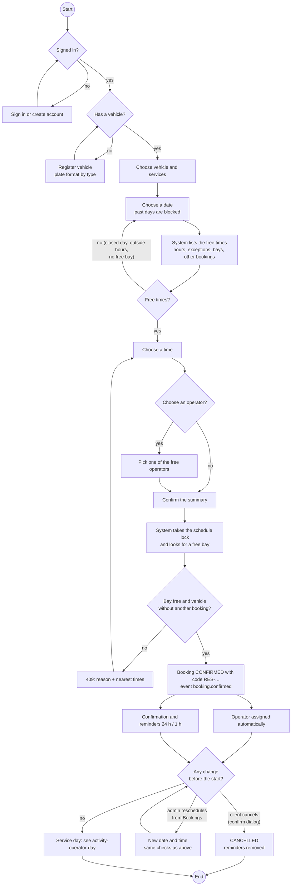

# Activity — Booking a wash, from the client's point of view (CU05, CU06, CU07)

Built from the web and app booking screens and `booking-service` (`BookingUseCase.availability /
create / reschedule / cancel`). Sequence with the services: [seq-booking](./seq-booking.md). The client
cancels from the history or the payment screen (confirm dialog, no reason asked); neither the web nor the app has a reschedule
screen for the client, so a new date is set by the administrator from Bookings (CU29). Checked on
2026-10-20.

