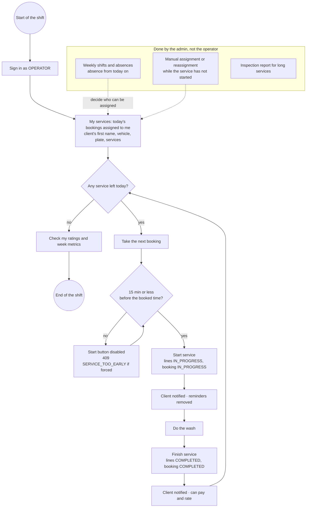

# Activity — An operator's working day (CU10, CU11, CU22)

Built from `operations-service` (`OperationsUseCase.myServices / start / finish`, `StartPolicy`,
`AssignmentPolicy`) and the operator screens of the app and web. Checked on 2026-10-19.

