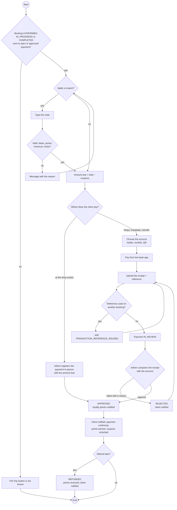

# Activity — Paying a booking and reviewing the payment (CU12, CU13, CU25)

Built from `payment-service` (`PaymentCommandService`, `CustomerPromotionService`, `PaymentPolicy`) and the
payment screens of the web and app. Sequences: [seq-payment](./seq-payment.md),
[seq-loyalty-coupon](./seq-loyalty-coupon.md). Checked on 2026-10-19.

