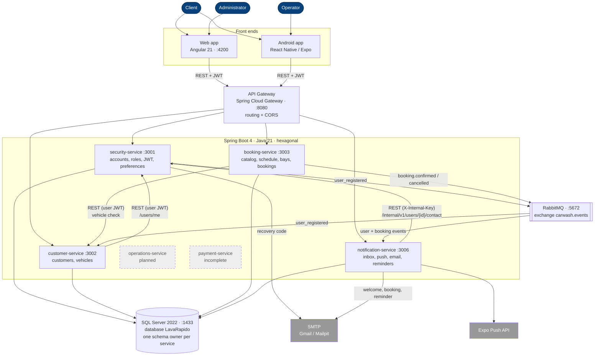

# C4 Level 2 — Containers (as built, 2026-10-04)

> Source of truth: `lavarapido-infra/docker-compose.yml`, each service's `application.yml` and
> REST clients. Dashed/"planned" elements are not built yet.

In development the web can also call the services directly through `Web/proxy.conf.json`
(same path table as the gateway).
