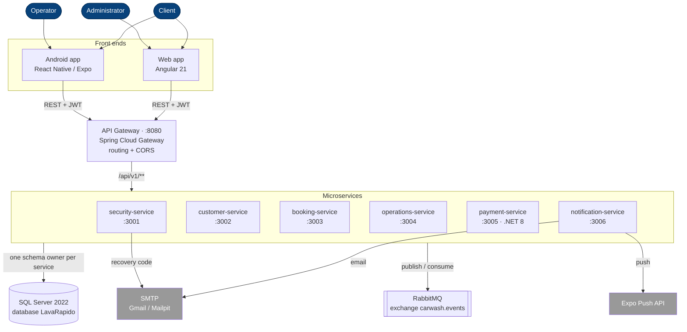
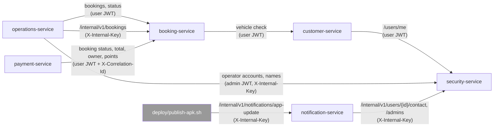
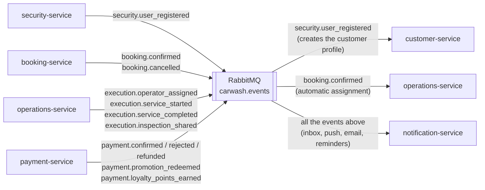

# C4 Level 2 — Containers (as built, 2026-10-19)

> Source of truth: `lavarapido-infra/docker-compose.yml`, each service's `application.yml` and
> REST clients. The view is split in three diagrams so each one can be read on its own: who enters
> the system, which service calls which, and which events travel through RabbitMQ.

## 1. Overview

| Service | What it owns | Schemas |
|---|---|---|
| security-service (Spring Boot 4, Java 21) | Accounts, roles, permissions, JWT, preferences, sessions | `security`, `audit` |
| customer-service (Spring Boot 4) | Customers and vehicles | `customer` |
| booking-service (Spring Boot 4) | Catalog, prices, schedule, bays, bookings, business data | `catalog`, `booking` |
| operations-service (Spring Boot 4) | Operators, shifts, assignment, execution, ratings, inspection report | `execution` |
| payment-service (.NET 8) | Payment accounts, payments, receipts, promotions, loyalty points | `payment`, `promotion` |
| notification-service (Spring Boot 4) | Inbox, push, email, reminders, staff alerts | `notification` |

## 2. Calls between services (REST)

## 3. Events (RabbitMQ, exchange `carwash.events`)

In development the web reaches the services through the gateway: `Web/proxy.conf.json` sends `/api`
to `http://localhost:8080`. In production Caddy serves the web and sends `/api` to the gateway over
HTTPS ([deployment-production](./deployment-production.md)). The `/internal/**` routes are not
published by the gateway; they need the `X-Internal-Key` header.

customer-service raises its own domain events (`customer.provisioned`, `customer.vehicle.*`) but only
writes them to the log; no other service needs them yet. security-service publishes only
`security.user_registered`; its other events (`security.user.deactivated`, email and password
changes) also stay in the log.
