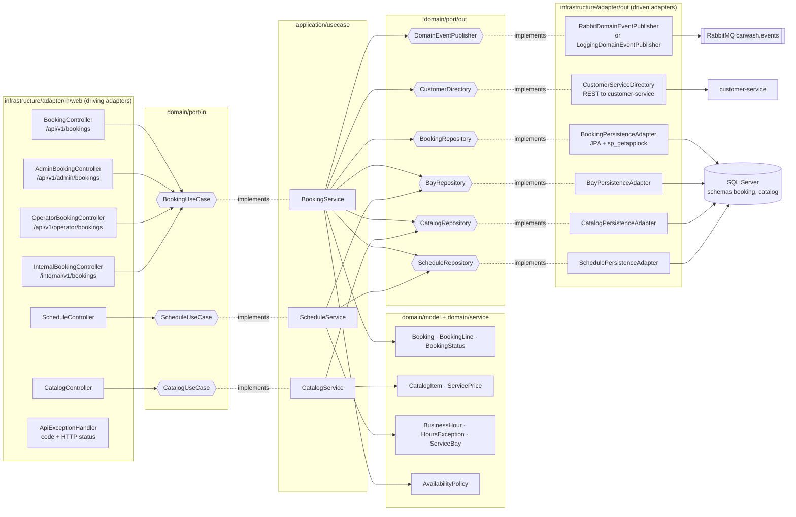

# C4 Level 3 — booking-service components (hexagonal)

Source: `lavarapido-booking-service/src/main/java/com/lavarapido/booking` as of 2026-10-19. The other
Java services follow the same layout (`domain` → `application` → `infrastructure`); booking is drawn
because it has every kind of adapter. ADR-002, ADR-009.

| Rule of the layout | How it shows in the code |
|---|---|
| The domain depends on nothing | `domain/model` and `domain/service` import no Spring or JPA class |
| Use cases only see ports | `BookingService` receives `BookingRepository`, `CustomerDirectory`… by constructor |
| Adapters are interchangeable | `RabbitDomainEventPublisher` runs with `app.messaging.enabled=true`; otherwise `LoggingDomainEventPublisher` |
| Tests replace the adapters | `BookingServiceTest` uses Mockito mocks of the out ports; `BookingApiWebTest` tests the controllers alone |
