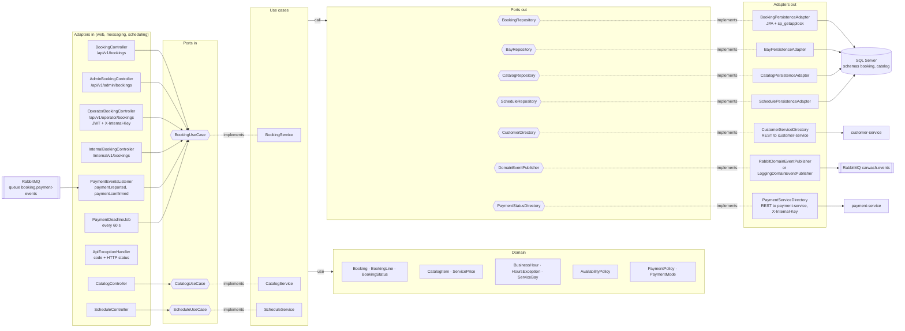

# C4 Level 3 — booking-service components (hexagonal)

Source: `lavarapido-booking-service/src/main/java/com/lavarapido/booking` as of 2026-10-19 (payment at booking added on 2026-10-26). The other
Java services follow the same layout (`domain` → `application` → `infrastructure`); booking is drawn
because it has every kind of adapter. ADR-002, ADR-009.

What each use case uses (the two arrows above, in detail):

| Use case | Domain | Ports out |
|---|---|---|
| `BookingService` | `Booking`, `BookingLine`, `BookingStatus`, `AvailabilityPolicy`, `PaymentPolicy`, `PaymentMode` | `BookingRepository`, `BayRepository`, `CatalogRepository`, `ScheduleRepository`, `CustomerDirectory`, `DomainEventPublisher`, `PaymentStatusDirectory` |
| `CatalogService` | `CatalogItem`, `ServicePrice` | `CatalogRepository` |
| `ScheduleService` | `BusinessHour`, `HoursException`, `ServiceBay` | `ScheduleRepository`, `BayRepository` |

Folders: adapters in = `infrastructure/adapter/in/web` (plus `in/messaging` and `in/scheduling`), ports in = `domain/port/in`, use cases =
`application/usecase`, domain = `domain/model` and `domain/service`, ports out = `domain/port/out`,
adapters out = `infrastructure/adapter/out`.

| Rule of the layout | How it shows in the code |
|---|---|
| The domain depends on nothing | `domain/model` and `domain/service` import no Spring or JPA class |
| Use cases only see ports | `BookingService` receives `BookingRepository`, `CustomerDirectory`… by constructor |
| Adapters are interchangeable | `RabbitDomainEventPublisher` runs with `app.messaging.enabled=true`; otherwise `LoggingDomainEventPublisher` |
| Tests replace the adapters | `BookingServiceTest` uses Mockito mocks of the out ports; `BookingApiWebTest` tests the controllers alone |
