# Class diagram — booking-service domain (catalog and booking)

Source: `lavarapido-booking-service/src/main/java/com/lavarapido/booking/domain` as of 2026-10-20; payment at
booking (`PaymentMode`, `PaymentPolicy`) and `AvailabilityPolicy.withoutBusyTimes` added on 2026-10-27 (`main`, `506feca`).
Getters, `restore(...)` factories and the 21 legal fields of `Establishment` are left out.

```mermaid
classDiagram
    direction LR
    class Booking {
        <<aggregate root>>
        -long id
        -long customerVehicleId
        -Short serviceBayId
        -Instant scheduledStart
        -Instant scheduledEnd
        -BookingStatus status
        -long bookedBy
        -int pointsRedeemed
        -BigDecimal pointsDiscountAmount
        -String notes
        -Instant createdAt
        -PaymentMode paymentMode
        -Instant paymentDeadline
        -Instant paymentReportedAt
        +confirmNew(long vehicleId, List~BookingLine~, Instant, Instant, ..., PaymentMode, Instant deadline)$ Booking
        +reschedule(List~BookingLine~, Instant, Instant, short bayId, String)
        +cancel(CancellationReason)
        +moveTo(BookingStatus)
        +changeableByCustomer(Instant) boolean
        +markPaymentReported(Instant) boolean
        +paymentOverdue(Instant) boolean
        +subtotal() BigDecimal
        +total() BigDecimal
        +durationMinutes() int
        +totalLoyaltyPoints() int
        +code() String
    }
    class BookingLine {
        <<value object>>
        long servicePriceId
        int serviceId
        String serviceCode
        String serviceName
        BigDecimal price
        short estimatedMinutes
        short quantity
        int loyaltyPoints
        +subtotal() BigDecimal
        +minutes() int
        +pointsEarned() int
    }
    class BookingStatus {
        <<enumeration>>
        SCHEDULED
        CONFIRMED
        IN_PROGRESS
        COMPLETED
        CANCELLED
        NO_SHOW
        +isChangeable() boolean
        +occupiesBay() boolean
    }
    class CancellationReason {
        <<value object>>
        short id
        String code
        String name
        boolean customerFault
        +selectableBy(boolean admin) boolean
    }
    class PaymentMode {
        <<enumeration>>
        DIGITAL
        CASH
        +of(String)$ PaymentMode
        +ofOptional(String)$ PaymentMode
    }
    class PaymentPolicy {
        <<domain service>>
        +deadlineFor(PaymentMode, Instant created, Instant start, Duration window)$ Instant
        +requireCashAllowed(long activeCash, int limit)$
    }
    class CatalogItem {
        <<aggregate root>>
        int id
        String code
        String name
        String description
        boolean active
        int loyaltyPoints
        +priceFor(short vehicleTypeId) Optional~ServicePrice~
    }
    class ServiceCategory {
        <<value object>>
        short id
        String code
        String name
        short displayOrder
    }
    class ServicePrice {
        <<value object>>
        long id
        int serviceId
        short vehicleTypeId
        BigDecimal price
        short estimatedMinutes
        LocalDate validFrom
        LocalDate validTo
    }
    class ServiceBay {
        <<value object>>
        short id
        String code
        String name
        BayStatus status
        +requireInitialStatus(BayStatus)$
    }
    class BayStatus {
        <<enumeration>>
        ACTIVE
        MAINTENANCE
        INACTIVE
        +acceptsBookings() boolean
    }
    class BusinessHour {
        <<value object>>
        short dayOfWeek
        boolean working
        LocalTime opensAt
        LocalTime closesAt
        LocalTime breakStartsAt
        LocalTime breakEndsAt
        +window() Optional~DayWindow~
    }
    class HoursException {
        <<value object>>
        int id
        LocalDate date
        boolean closed
        LocalTime opensAt
        LocalTime closesAt
        String reason
        +window() Optional~DayWindow~
    }
    class DayWindow {
        <<value object>>
        LocalTime opensAt
        LocalTime closesAt
        LocalTime breakStartsAt
        LocalTime breakEndsAt
        +hasBreak() boolean
    }
    class Establishment {
        <<value object>>
        String legalName
        String tradeName
        String taxId
        String address
        String phone
        String email
        +requireValid()
    }
    class ScheduleHistoryEntry {
        <<value object>>
        long id
        ScheduleEntityType entityType
        String title
        String detail
        Instant changedAt
        Long changedBy
    }
    class ScheduleEntityType {
        <<enumeration>>
        WEEK
        EXCEPTION
        BAY
    }
    class AvailabilityPolicy {
        <<domain service>>
        +slots(LocalDate, Optional~DayWindow~, List~Short~ bays, ...) List~Slot~
        +freeBay(LocalDateTime, LocalDateTime, List~Short~, ...) Optional~Short~
        +alternatives(List~Slot~, LocalTime, int max) List~LocalTime~
        +withoutBusyTimes(List~Slot~, LocalDate, int minutes, List~Occupancy~)$ List~Slot~
        +whyUnavailable(List~Slot~, Optional~DayWindow~, ...) UnavailableReason
    }
    class UnavailableReason {
        <<enumeration>>
        CLOSED_DAY
        OUTSIDE_HOURS
        TIME_PASSED
        NO_FREE_BAY
    }
    class VehicleSnapshot {
        <<value object>>
        long id
        String licensePlate
        short vehicleTypeId
        String brand
        String model
        Long ownerUserId
    }

    Booking "1" *-- "1..*" BookingLine : lines
    Booking --> BookingStatus
    Booking --> "0..1" CancellationReason
    Booking --> "0..1" PaymentMode
    Booking ..> ServiceBay : serviceBayId
    Booking ..> VehicleSnapshot : customerVehicleId (customer-service)
    BookingLine ..> ServicePrice : servicePriceId
    CatalogItem --> ServiceCategory : category
    CatalogItem "1" *-- "1..*" ServicePrice : prices
    ServiceBay --> BayStatus
    BusinessHour ..> DayWindow
    HoursException ..> DayWindow
    ScheduleHistoryEntry --> ScheduleEntityType
    AvailabilityPolicy ..> DayWindow
    AvailabilityPolicy ..> ServiceBay
    AvailabilityPolicy ..> UnavailableReason
```

Rules kept by these classes:

- A booking only takes a time with a free bay inside the day window (`AvailabilityPolicy`); when it is
  not possible, the API answers 409 with the `reason` from `UnavailableReason` and the nearest
  `alternatives` (5 by default, `app.booking.alternatives`).
- Payment at booking (ADR-021): `PaymentMode.of` makes the client choose `DIGITAL` or `CASH` (400
  `INVALID_PAYMENT_MODE`); `PaymentPolicy.requireCashAllowed` refuses a second active cash booking (409
  `CASH_BOOKING_LIMIT`); `PaymentPolicy.deadlineFor` gives a `DIGITAL` booking `min(creation + 30 min, start)`.
  `paymentOverdue` is true for a `DIGITAL` booking still `SCHEDULED` or `CONFIRMED`, past its deadline and
  without `paymentReportedAt`; `markPaymentReported` records the first report (event or check). The reasons
  `EXPIRED` and `PAYMENT_TIMEOUT` are not selectable by anyone (`CancellationReason.selectableBy`).
- The alternatives skip the times when the same vehicle has another booking (`withoutBusyTimes`, 2026-10-27).
- `changeableByCustomer` allows a client change only while the booking is `SCHEDULED` or `CONFIRMED`
  and its start time has not passed; the admin only needs the status (`BookingService.requireChangeableBy`).
  In practice the client only cancels (reason `CUSTOMER_REQUEST`, nothing asked); rescheduling is done
  by the admin, and the client reschedule endpoint is not used by the web or the app.
- A bay in `MAINTENANCE` or `INACTIVE` does not accept bookings, and a new bay cannot be created in
  maintenance (`ServiceBay.requireInitialStatus`).
- Each line points to the `ServicePrice` valid for the vehicle type. A price row is never edited: a
  change closes it (`validTo`) and inserts a new one, so past bookings keep the price they had.
- Event published: `BookingEvent` with three types, `booking.confirmed` (on create, on reschedule and
  when the admin moves a booking back to confirmed, with `preferredOperatorId` when the customer chose
  one), `booking.cancelled` (with the reason) and, since 2026-10-23, `booking.status_changed` (with
  `status`, when the admin sets in progress, completed or no-show, A-11).
