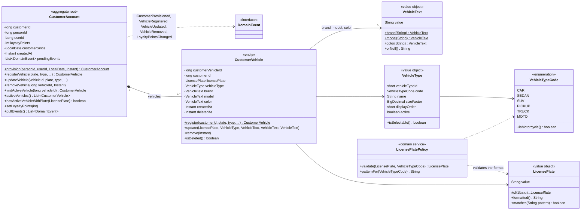

# Class diagram — customer-service domain

Source: `lavarapido-customer-service/src/main/java/com/lavarapido/customer/domain` as of 2026-10-20.
Getters, `restore(...)` factories and `equals`/`hashCode` are left out.

Rules kept by these classes:

- A customer account is created (`provision`) when `security.user.registered` arrives; the handler is
  idempotent (one account per user). If the event was lost, the account is created on the first
  vehicle request, asking security-service for the person (`IdentityDirectory`).
- The same plate cannot be active twice in the whole system: `CustomerVehicleService.requirePlateFree`
  checks it (409 `PLATE_ALREADY_REGISTERED`) and the filtered unique index
  `ux_customer_vehicle_plate_active` backs it; the aggregate also checks its own account
  (`hasActiveVehicleWithPlate`). The plate format depends on the vehicle type (`LicensePlatePolicy`): `ABC123` for cars and trucks, `ABC12D`
  for motorcycles.
- Removing a vehicle is a soft delete (`deletedAt`), so past bookings keep pointing to it.
- The domain events (`CustomerProvisioned`, `VehicleRegistered`, `VehicleUpdated`, `VehicleRemoved`,
  `LoyaltyPointsChanged`) are only written to the log (`LoggingDomainEventPublisher`); customer-service
  publishes nothing to RabbitMQ.
- `loyaltyPoints` is a cached balance; the ledger that owns the points is
  `payment.loyalty_transaction` ([class-payment](./class-payment.md)).
