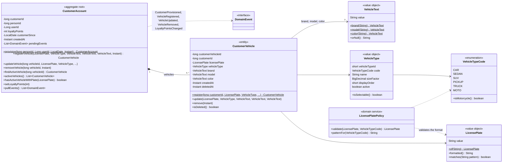

# Class diagram — customer-service domain

Source: `lavarapido-customer-service/src/main/java/com/lavarapido/customer/domain` as of 2026-10-19.
Getters, `restore(...)` factories and `equals`/`hashCode` are left out.

Rules kept by these classes:

- A customer account is created (`provision`) when `security.user.registered` arrives; the handler is
  idempotent (one account per user). If the event was lost, the account is created on the first
  vehicle request, asking security-service for the person (`IdentityDirectory`).
- The same plate cannot be active twice in one account (`hasActiveVehicleWithPlate`), and the plate
  format depends on the vehicle type (`LicensePlatePolicy`): `ABC123` for cars and trucks, `ABC12D`
  for motorcycles.
- Removing a vehicle is a soft delete (`deletedAt`), so past bookings keep pointing to it.
- `loyaltyPoints` is a cached balance; the ledger that owns the points is
  `payment.loyalty_transaction` ([class-payment](./class-payment.md)).
