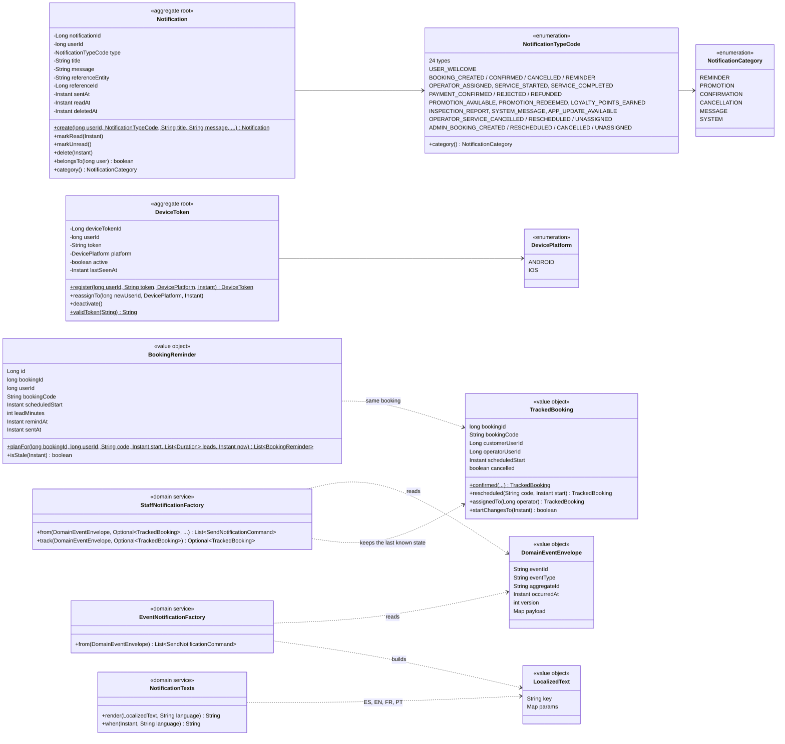

# Class diagram — notification-service domain

Source: `lavarapido-notification-service/src/main/java/com/lavarapido/notification/domain` as of
2026-10-19. Getters, `restore(...)` factories and paging records are left out.

Rules kept by these classes:

- Every event is handled once: its `eventId` goes to `notification.processed_event`, so a repeated
  delivery from RabbitMQ creates nothing.
- One event can produce several notifications: the customer's (`EventNotificationFactory`) and the
  operator's and administrators' (`StaffNotificationFactory`), which compares the event with the
  `TrackedBooking` to know if the booking was rescheduled, reassigned or cancelled.
- Texts are stored as keys and rendered in the user's language (`NotificationTexts`).
- `BookingReminder.planFor` plans one reminder per lead (`REMINDER_LEADS`, `24h,1h` by default) and
  skips the ones already in the past. A new plan replaces the old one when the booking is
  rescheduled; cancelling, starting or finishing the service removes the pending ones; and a reminder
  found after the booking time (`isStale`) is closed without being sent.
- `DeviceToken.validToken` accepts only Expo push tokens (`ExponentPushToken[...]`); a token that
  appears for another user is reassigned, not duplicated.
