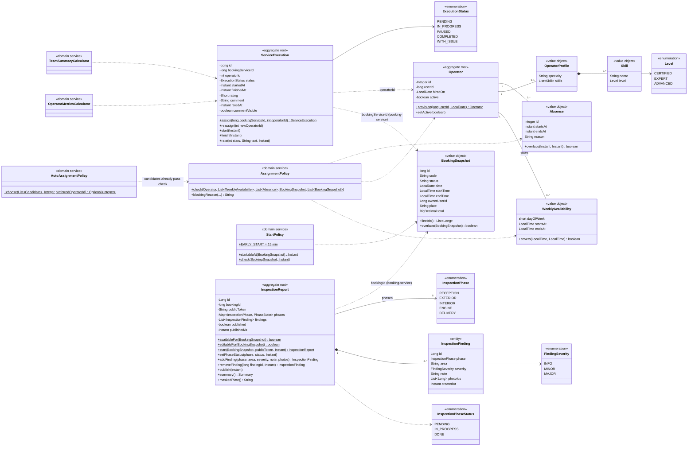

# Class diagram — operations-service domain (execution and inspection)

Source: `lavarapido-operation-service/src/main/java/com/lavarapido/operations/domain` as of 2026-10-20.
Getters, `restore(...)` factories and the read-only metric records (`OperatorWeekMetrics`,
`TeamSummary`) are left out.

Rules kept by these classes:

- `AssignmentPolicy` rejects, in this order, an inactive operator (`OPERATOR_INACTIVE`), one without a
  shift that covers the booking (`OPERATOR_NOT_ON_SHIFT`), an absent one (`OPERATOR_ABSENT`) and one
  with another booking at that time (`OPERATOR_BUSY`); the API answers 409 with that code.
- `AutoAssignmentPolicy` takes the operator the customer chose when they are available; otherwise, the
  available operator with the fewest bookings that day (ties by the lowest id).
- `StartPolicy` lets a service start at most 15 minutes before the scheduled time.
- An absence is registered from today on; one that starts before today is rejected with 400
  `ABSENCE_IN_PAST`.
- A service can be rated once, only when `COMPLETED`, with 1 to 5 stars.
- The inspection report is only for services of at least 180 minutes. It is started and edited while
  the booking is `CONFIRMED` or `IN_PROGRESS` (`requireEditable`); with the booking `COMPLETED` it is
  still shown (`availableFor`), and once published the customer opens it with `publicToken` (plate
  masked).
- Events published: `execution.operator_assigned`, `execution.service_started`,
  `execution.service_completed` (`ExecutionEvent`) and `execution.inspection_shared`
  (`InspectionSharedEvent`).
