# Class diagram — payment-service domain (payments, promotions and loyalty)

Source: `lavarapido-payment-service/src/PaymentService.Domain` (.NET 8) as of 2026-10-19. Length
constants, `Guard` and error codes are left out.

```mermaid
classDiagram
    class LoyaltyBalance {
        <<value object>>
        +Points int
        +Sequence int
    }
    class PaymentApproved {
        <<domain event>>
        long BookingId
        decimal Amount
    }
    direction LR
    class PercentageDiscountStrategy
    class FixedAmountDiscountStrategy
    class PaymentPolicy {
        <<static domain service>>
        +IsBookingPayable(string bookingStatus)$ bool
        +CanReportPayment(string bookingStatus, IEnumerable~PaymentStatus~)$ bool
        +AmountDue(decimal bookingTotal, decimal appliedDiscounts)$ decimal
    }
    class RedemptionRequest {
        <<value object>>
        long BookingId
        string BookingCode
        long CustomerUserId
        int CustomerPoints
        decimal Subtotal
        bool AlreadyRedeemedOnBooking
        int TotalRedemptions
        int CustomerRedemptions
    }
    class IDiscountStrategy {
        <<interface>>
        +Calculate(decimal subtotal, decimal value) decimal
        +Validate(decimal value)
    }
    class Promotion {
        <<aggregate root>>
        +Code string
        +Name string
        +DiscountType DiscountType
        +DiscountValue decimal
        +MaxDiscountAmount decimal?
        +MinPurchaseAmount decimal
        +ValidFrom DateOnly
        +ValidTo DateOnly
        +IsActive bool
        +MaxRedemptions int?
        +MaxRedemptionsPerCustomer int?
        +RequiredPoints int
        +Featured bool
        +Create(PromotionDefinition)$ Promotion
        +Update(PromotionDefinition)
        +SetActive(bool)
        +IsAvailableOn(DateOnly) bool
        +IsUnlockedFor(int customerPoints) bool
        +IsUnlockedBy(int before, int after, DateOnly) bool
        +CalculateDiscount(decimal subtotal) decimal
        +Redeem(RedemptionRequest) PromotionRedemption
    }
    class AggregateRoot~TId~ {
        <<abstract>>
        +DomainEvents IReadOnlyCollection~IDomainEvent~
        #AddDomainEvent(IDomainEvent)
        +ClearDomainEvents()
    }
    class PromotionRedemption {
        <<entity>>
        +BookingId long
        +PromotionId int
        +AppliedAmount decimal
        +RedeemedBy long?
        +RedeemedAtUtc DateTime
    }
    class PromotionRedeemed {
        <<domain event>>
        int PromotionId
        long BookingId
        long CustomerUserId
        decimal DiscountAmount
    }
    class DiscountStrategyFactory {
        +For(DiscountType)$ IDiscountStrategy
    }
    class LoyaltyTransaction {
        <<entity>>
        +CustomerId long
        +MovementType LoyaltyMovementType
        +Sequence int
        +BookingId long?
        +Points int
        +BalanceAfter int
        +ExpiresOn DateOnly?
        +Earn(long customerId, long bookingId, int points, LoyaltyBalance, long?, DateTime)$ LoyaltyTransaction
        +ReverseEarned(long customerId, long bookingId, int earned, LoyaltyBalance, ...)$ LoyaltyTransaction?
    }
    class PaymentRefunded {
        <<domain event>>
        long BookingId
        decimal Amount
    }
    class PaymentMethodType {
        <<entity>>
        +Code string
        +Name string
        +RequiresAccount bool
        +RequiresReceipt bool
        +DisplayOrder short
        +IsActive bool
    }
    class PaymentStatus {
        <<enumeration>>
        Pending
        InReview
        Approved
        Rejected
        Refunded
    }
    class Entity~TId~ {
        <<abstract>>
        +Id TId
    }
    class PaymentReceipt {
        <<entity>>
        +FileUrl string
        +TransactionReference string?
        +ReportedAmount decimal?
        +UploadedBy long
        +UploadedAtUtc DateTime
        +ReviewedBy long?
        +ReviewedAtUtc DateTime?
        +ReviewComment string?
    }
    class DiscountType {
        <<enumeration>>
        Percentage
        FixedAmount
        Package
    }
    class LoyaltyMovementType {
        <<enumeration>>
        Earned
        Redeemed
        Expired
        Adjusted
        Reversed
    }
    class PaymentRejected {
        <<domain event>>
        long BookingId
        decimal Amount
        string Reason
    }
    class Payment {
        <<aggregate root>>
        +BookingId long
        +PaymentAccountId short
        +Amount decimal
        +Status PaymentStatus
        +ProcessedAtUtc DateTime?
        +ApprovedBy long?
        +RejectionReason string?
        +Create(long bookingId, short accountId, decimal amount)$ Payment
        +ReportWithReceipt(long, short, decimal, string fileUrl, ...)$ Payment
        +RegisterInPerson(long, short, decimal, long registeredBy, string?, DateTime)$ Payment
        +AttachReceipt(string fileUrl, long uploadedBy, DateTime, ...)
        +SubmitForReview()
        +Approve(long approvedBy, DateTime)
        +Reject(long rejectedBy, string reason, DateTime)
        +Refund(DateTime)
    }
    class PaymentAccount {
        <<entity>>
        +PaymentMethodTypeId short
        +AccountHolder string
        +AccountNumber string?
        +QrImageUrl string?
        +Instructions string?
        +IsActive bool
        +Create(PaymentMethodType, string holder, string? number, ...)$ PaymentAccount
        +Update(PaymentMethodType, string holder, string? number, string? qr, ...)
    }
    PercentageDiscountStrategy ..|> IDiscountStrategy
    AggregateRoot~TId~ --|> Entity~TId~
    LoyaltyTransaction --|> Entity~TId~
    Payment ..> PaymentAccount : PaymentAccountId
    Payment ..> PaymentApproved : raises
    PaymentAccount --> PaymentMethodType
    Payment --|> AggregateRoot~TId~
    LoyaltyTransaction --> LoyaltyMovementType
    Promotion ..> PromotionRedemption : creates
    Promotion --> DiscountType
    FixedAmountDiscountStrategy ..|> IDiscountStrategy
    Payment "1" *-- "0..*" PaymentReceipt : receipts
    Promotion ..> PromotionRedeemed : raises
    Payment --> PaymentStatus
    DiscountStrategyFactory ..> IDiscountStrategy
    PaymentAccount --|> Entity~TId~
    Promotion --|> AggregateRoot~TId~
    Promotion ..> DiscountStrategyFactory
    Promotion ..> RedemptionRequest
    Payment ..> PaymentRejected : raises
    Payment ..> PaymentRefunded : raises
    LoyaltyTransaction ..> LoyaltyBalance
```

Rules kept by these classes:

- Transitions: `Pending → InReview` (receipt attached and sent), `InReview → Approved | Rejected`,
  `Approved → Refunded`; any other one fails with `INVALID_PAYMENT_STATUS_TRANSITION`
  ([state-payment](./state-payment.md)). `RegisterInPerson` goes through the same steps in one call and
  ends `Approved`.
- `PaymentPolicy`: a booking is payable when it is `CONFIRMED`, `IN_PROGRESS` or `COMPLETED`, and only
  while it has no approved or open payment. The amount due is the booking total minus the coupons
  already applied, never negative.
- `Promotion.Redeem` checks, in this order: valid date range, enough points (`RequiredPoints`), not
  redeemed on that booking yet, minimum purchase, total limit and limit per customer.
- Loyalty: when a payment is approved, `LoyaltyRewardService` (application layer) credits the points of
  the booking lines with `LoyaltyTransaction.Earn`; a refund reverses them with `ReverseEarned`. Both
  are idempotent per booking. `CustomerId` holds the customer's user id.
- Events published to `carwash.events`: `payment.confirmed`, `payment.rejected`, `payment.refunded`,
  `payment.promotion_redeemed` and `payment.loyalty_points_earned`.
