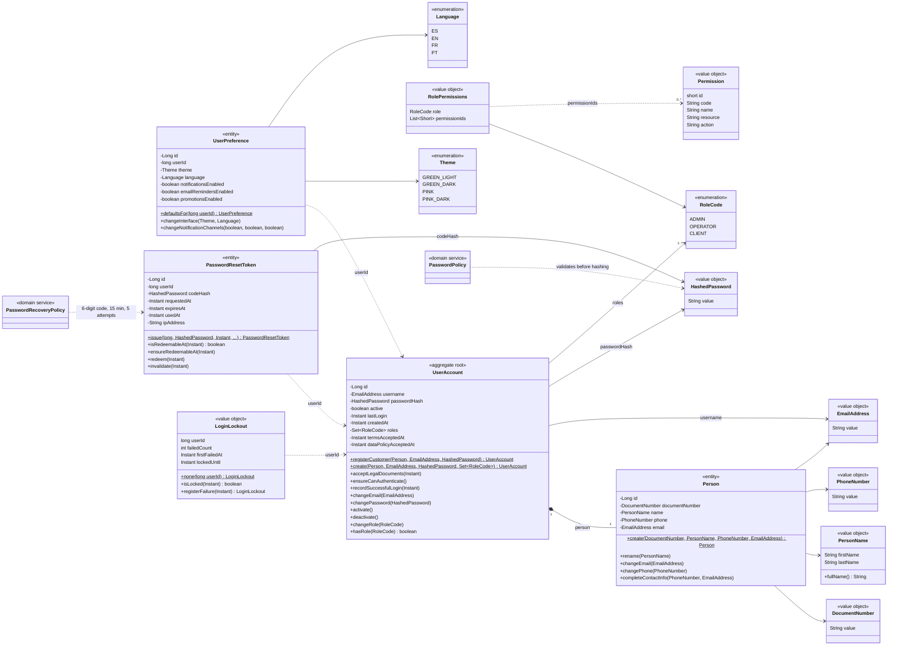

# Class diagram — security-service domain

Source: `lavarapido-security-service/src/main/java/com/lavarapido/security/domain` (`model`, `service`,
`port`) as of 2026-10-19. Getters, `reconstitute(...)` factories and `equals`/`hashCode` are left out.

Rules kept by these classes:

- `UserAccount.ensureCanAuthenticate()` rejects an inactive account; `LoginLockout` locks the account
  after 5 failed attempts in 15 minutes (HTTP 423) and a successful login clears it.
- `UserAccount.registerCustomer(...)` always gives the `CLIENT` role; staff accounts are created with
  `create(...)` by an administrator. An account has one role: `changeRole` replaces it (an admin cannot
  change their own), and an admin account cannot be deactivated until its role is changed.
- `PasswordResetToken` can be redeemed once, before `expiresAt`; asking for a new code invalidates the
  previous one.
- Domain events published: `UserRegistered`, `EmailChanged`, `PasswordChanged`, `AccountDeactivated`.
