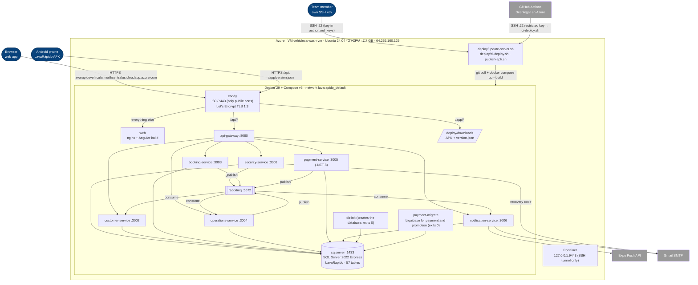

# Deployment — Production on Azure (as running on 2026-10-19)

Source: `lavarapido-infra/docker-compose.yml` + `docker-compose.prod.yml`, `deploy/Caddyfile`,
`deploy/update-server.sh`, `deploy/ci-deploy.sh`, `.github/workflows/deploy.yml`, and the server itself
(`docker ps`, read on 2026-10-19). Details and measurements: `10-devops/production.md` and the
Deployment Document of `lavarapido-docs`.

| Node | Notes |
|---|---|
| Caddy | Only container with published ports; obtains and renews the certificate (valid until 2027-01-14 at the last check) |
| Services | No ports on the host; Swagger off; memory limit per container, `restart: unless-stopped` |
| SQL Server | Express edition; data in the `sqlserver-data` volume. `db-init` only creates the database; each Java service applies its Liquibase changelog on start-up and `payment-migrate` applies the .NET service's (global numbering up to 039) |
| Mailpit | Not started in production (`dev-only` profile) |
| Portainer | Bound to `127.0.0.1`; reached through an SSH tunnel |
| Access | Members with their own key; GitHub Actions with a restricted key that can only run `ci-deploy.sh` |
