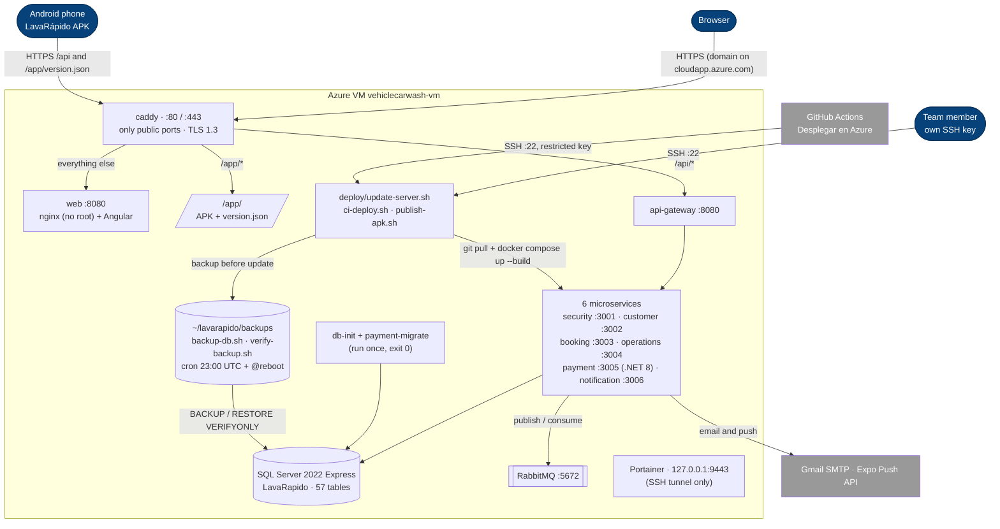

# Deployment — Production on Azure (as running on 2026-10-19, files checked on 2026-10-23)

Source: `lavarapido-infra/docker-compose.yml` + `docker-compose.prod.yml`, `deploy/Caddyfile`,
`deploy/update-server.sh`, `deploy/ci-deploy.sh`, `.github/workflows/deploy.yml`, and the server itself
(`docker ps`, read on 2026-10-19). Details and measurements: `10-devops/production.md` and the
Deployment Document of `lavarapido-docs`. Decision: ADR-016. The server follows `develop` and is
updated by hand; the GitHub Actions path is drawn as it is configured, but on 2026-10-23 it had never
run (no `AZURE_SSH_KEY` secret).

| Node | Notes |
|---|---|
| Server | Azure VM `vehiclecarwash-vm` (Ubuntu 24.04, 2 vCPU, 7.7 GB), domain `lavarapidovehicular.northcentralus.cloudapp.azure.com`, public IP 64.236.160.129, Docker 29 and Compose v5; every container is in the network `lavarapido_default` |
| Caddy | Only container with published ports; obtains and renews the certificate (valid until 2027-01-14 at the last check) |
| Services | Which service calls which and the events they exchange: [c2-containers](./c2-containers.md). No ports on the host; Swagger off; memory limit per container, `restart: unless-stopped` |
| SQL Server | Express edition; data in the `sqlserver-data` volume. `db-init` creates the database (recovery model `SIMPLE`); each Java service applies its Liquibase changelog on start-up (global numbering up to 047 and seeds up to 116 in `origin/develop` on 2026-10-24) and `payment-migrate` applies the .NET service's (own numbering up to 023) |
| Backups | `backup-db.sh` and `verify-backup.sh` run by cron (daily 23:00 UTC and 5 min after boot) and before each update; 14 regular and 10 `pre-update` kept on the VM disk; `restore-db.sh` and `rollback.sh` (`:prev` images) by hand (`13-operations/README.md`) |
| Mailpit | Not started in production (`dev-only` profile) |
| Portainer | Bound to `127.0.0.1`; reached through an SSH tunnel |
| Access | Members with their own key; GitHub Actions with a restricted key that can only run `ci-deploy.sh` (key and secret still to be created). Continuous deployment from `main` with `boot-update.sh` is merged into `develop` since 2026-10-24, not run yet (ADR-017) |
