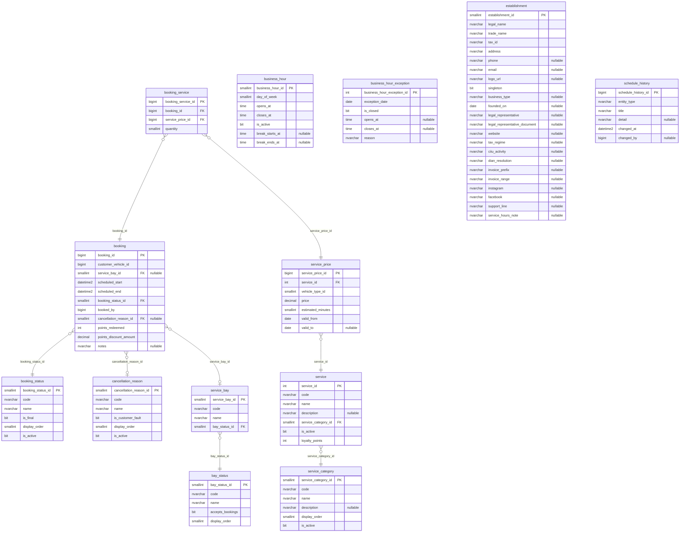

# ER — Schemas catalog and booking (booking-service, 13 tables)

Source: the `LavaRapido` database read on 2026-10-19 (`sys.tables`, `sys.columns`, `sys.foreign_keys`) with every
migration applied (up to 039). The audit block (`created_at`, `created_by`, `updated_at`, `updated_by`,
`deleted_at`, `deleted_by`, `row_version`) is left out to keep the diagram readable; 12 of the 13 tables have some or all of these columns.

References to other services have no foreign key (ADR-003); they are kept by the code:

| Column | Points to | Owner |
|---|---|---|
| `booking.booking.customer_vehicle_id` | `customer.customer_vehicle` | customer-service |
| `booking.booking.booked_by` | `security.app_user` | security-service |
| `booking.schedule_history.changed_by` | `security.app_user` | security-service |
| `catalog.service_price.vehicle_type_id` | `customer.vehicle_type` | customer-service |
