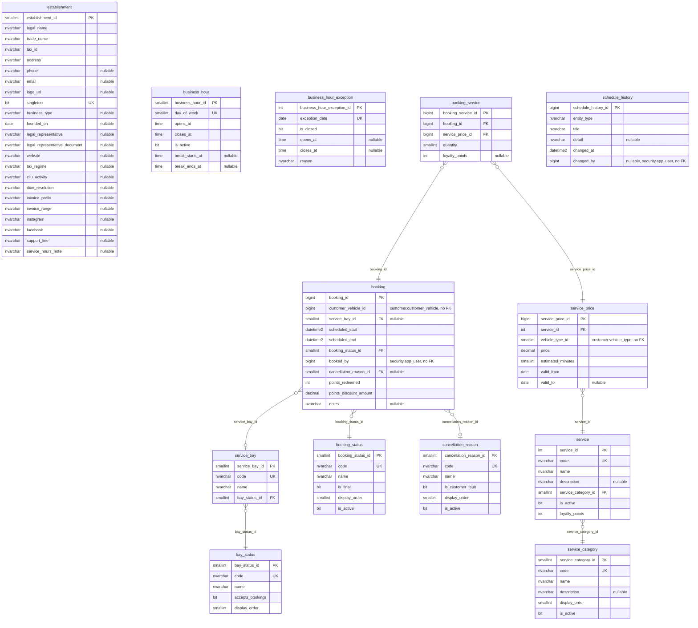

# ER — Schemas catalog and booking (booking-service, 13 tables)

Source: the Liquibase changelogs of `lavarapido-booking-service` on `origin/develop` (`5dd6794`, 2026-10-24), every changeset applied (last structural file: `045-booking-row-version-optimistic-lock.sql`). Each entity lists all its columns except the standard audit block, which is in the table under the diagram. Types are the SQL Server base type; lengths, precision and defaults are in `09-microservices/services/04-booking-service/data-model.md`. `PK`, `FK` and `UK` (unique, alone or filtered) are the database keys; "nullable" marks columns that accept NULL. One relationship per foreign key, labelled with its column.

## Audit columns

The standard block is `created_at`, `created_by`, `updated_at`, `updated_by`, `deleted_at`, `deleted_by`, `row_version` (`06-data/modeling-conventions.md`).

| Table | Audit columns |
|---|---|
| `catalog.service_category` | all seven |
| `catalog.service` | all seven |
| `catalog.service_price` | all seven |
| `booking.establishment` | all seven |
| `booking.business_hour` | all seven |
| `booking.business_hour_exception` | all seven |
| `booking.service_bay` | all seven |
| `booking.booking_status` | all seven |
| `booking.cancellation_reason` | all seven |
| `booking.booking` | all seven |
| `booking.booking_service` | all seven |
| `booking.bay_status` | all seven |
| `booking.schedule_history` | — |

## References to other services

They have no foreign key (ADR-003); the code keeps them consistent.

| Column | Points to | Owner |
|---|---|---|
| `catalog.service_price.vehicle_type_id` | `customer.vehicle_type` | customer-service |
| `booking.booking.customer_vehicle_id` | `customer.customer_vehicle` | customer-service |
| `booking.booking.booked_by` | `security.app_user` | security-service |
| `booking.schedule_history.changed_by` | `security.app_user` | security-service |
