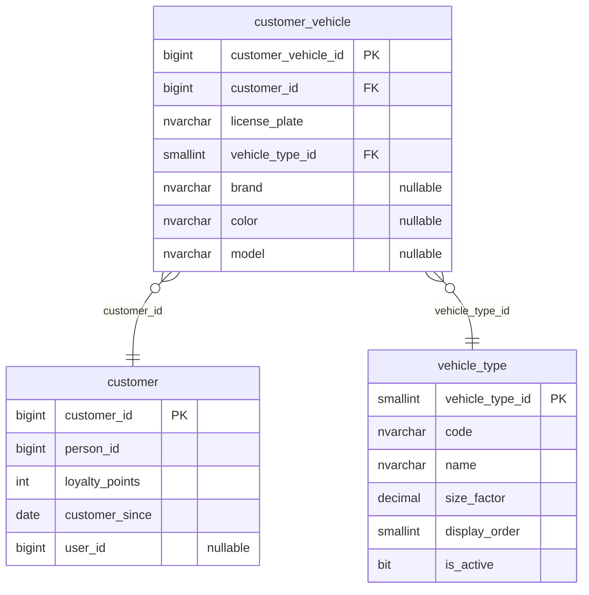

# ER — Schemas customer (customer-service, 3 tables)

Source: the `LavaRapido` database read on 2026-10-19 (`sys.tables`, `sys.columns`, `sys.foreign_keys`) with every
migration applied (up to 039). The audit block (`created_at`, `created_by`, `updated_at`, `updated_by`,
`deleted_at`, `deleted_by`, `row_version`) is left out to keep the diagram readable; 3 of the 3 tables have some or all of these columns.

References to other services have no foreign key (ADR-003); they are kept by the code:

| Column | Points to | Owner |
|---|---|---|
| `customer.customer.person_id` | `security.person` | security-service |
| `customer.customer.user_id` | `security.app_user` | security-service |
