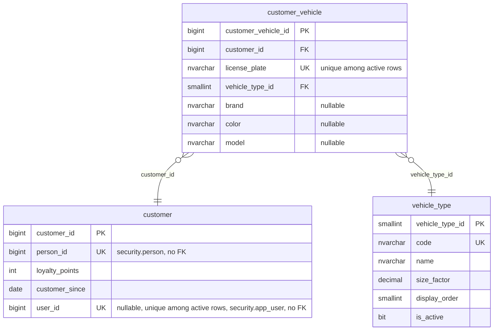

# ER — Schema customer (customer-service, 3 tables)

Source: the Liquibase changelogs of `lavarapido-customer-service` on `origin/develop` (`3181cae`, 2026-10-24), every changeset applied (last structural file: `015-add-customer-vehicle-model.sql`). Each entity lists all its columns except the standard audit block, which is in the table under the diagram. Types are the SQL Server base type; lengths, precision and defaults are in `09-microservices/services/03-customer-service/data-model.md`. `PK`, `FK` and `UK` (unique, alone or filtered) are the database keys; "nullable" marks columns that accept NULL. One relationship per foreign key, labelled with its column.

## Audit columns

The standard block is `created_at`, `created_by`, `updated_at`, `updated_by`, `deleted_at`, `deleted_by`, `row_version` (`06-data/modeling-conventions.md`).

| Table | Audit columns |
|---|---|
| `customer.vehicle_type` | all seven |
| `customer.customer` | all seven |
| `customer.customer_vehicle` | all seven |

## References to other services

They have no foreign key (ADR-003); the code keeps them consistent.

| Column | Points to | Owner |
|---|---|---|
| `customer.customer.person_id` | `security.person` | security-service |
| `customer.customer.user_id` | `security.app_user` | security-service |
