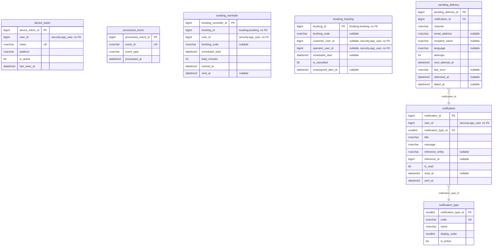

# ER — Schema notification (notification-service, 7 tables)

Source: the Liquibase changelogs of `lavarapido-notification-service` on `origin/develop` (`3f99df4`, 2026-10-24), every changeset applied (last structural file: `048-notification-pending-delivery-nvarchar.sql`). Each entity lists all its columns except the standard audit block, which is in the table under the diagram. Types are the SQL Server base type; lengths, precision and defaults are in `09-microservices/services/07-notification-service/data-model.md`. `PK`, `FK` and `UK` (unique, alone or filtered) are the database keys; "nullable" marks columns that accept NULL. One relationship per foreign key, labelled with its column.

## Audit columns

The standard block is `created_at`, `created_by`, `updated_at`, `updated_by`, `deleted_at`, `deleted_by`, `row_version` (`06-data/modeling-conventions.md`).

| Table | Audit columns |
|---|---|
| `notification.notification_type` | all seven |
| `notification.notification` | all seven |
| `notification.device_token` | all seven |
| `notification.processed_event` | all seven |
| `notification.booking_reminder` | all seven |
| `notification.booking_tracking` | updated_at |
| `notification.pending_delivery` | created_at |

## References to other services

They have no foreign key (ADR-003); the code keeps them consistent.

| Column | Points to | Owner |
|---|---|---|
| `notification.notification.user_id` | `security.app_user` | security-service |
| `notification.device_token.user_id` | `security.app_user` | security-service |
| `notification.booking_reminder.booking_id` | `booking.booking` | booking-service |
| `notification.booking_reminder.user_id` | `security.app_user` | security-service |
| `notification.booking_tracking.booking_id` | `booking.booking` | booking-service |
| `notification.booking_tracking.customer_user_id` | `security.app_user` | security-service |
| `notification.booking_tracking.operator_user_id` | `security.app_user` | security-service |
