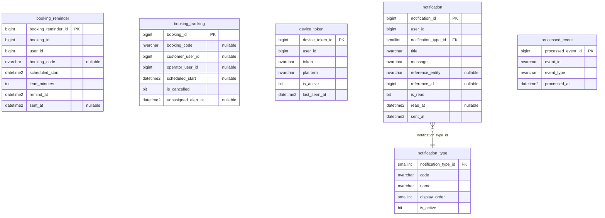

# ER — Schemas notification (notification-service, 6 tables)

Source: the `LavaRapido` database read on 2026-10-19 (`sys.tables`, `sys.columns`, `sys.foreign_keys`) with every
migration applied (up to 039). The audit block (`created_at`, `created_by`, `updated_at`, `updated_by`,
`deleted_at`, `deleted_by`, `row_version`) is left out to keep the diagram readable; 6 of the 6 tables have it.

References to other services have no foreign key (ADR-003); they are kept by the code:

| Column | Points to | Owner |
|---|---|---|
| `notification.booking_reminder.booking_id` | `booking.booking` | booking-service |
| `notification.booking_reminder.user_id` | `security.app_user` | security-service |
| `notification.booking_tracking.customer_user_id` | `security.app_user` | security-service |
| `notification.booking_tracking.operator_user_id` | `security.app_user` | security-service |
| `notification.device_token.user_id` | `security.app_user` | security-service |
| `notification.notification.user_id` | `security.app_user` | security-service |
| `notification.notification.reference_id` | the row named by `reference_entity` (`booking`, `payment` or `app_version`) | booking-service, payment-service |
