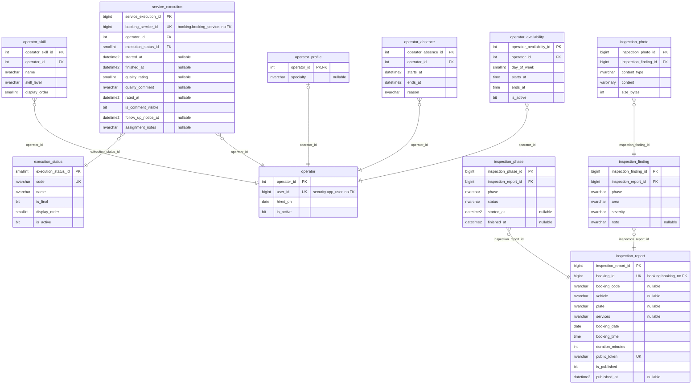

# ER — Schema execution (operations-service, 11 tables)

Source: the Liquibase changelogs of `lavarapido-operations-service` on `origin/develop` (`37e32ff`, 2026-10-24), every changeset applied (last structural file: `042-execution-assignment-notes.sql`). Each entity lists all its columns except the standard audit block, which is in the table under the diagram. Types are the SQL Server base type; lengths, precision and defaults are in `09-microservices/services/05-operations-service/data-model.md`. `PK`, `FK` and `UK` (unique, alone or filtered) are the database keys; "nullable" marks columns that accept NULL. One relationship per foreign key, labelled with its column.

## Audit columns

The standard block is `created_at`, `created_by`, `updated_at`, `updated_by`, `deleted_at`, `deleted_by`, `row_version` (`06-data/modeling-conventions.md`).

| Table | Audit columns |
|---|---|
| `execution.execution_status` | all seven |
| `execution.operator` | all seven |
| `execution.operator_availability` | all seven |
| `execution.operator_absence` | all seven |
| `execution.service_execution` | all seven |
| `execution.inspection_report` | created_at, created_by, updated_at, updated_by, row_version |
| `execution.inspection_phase` | — |
| `execution.inspection_finding` | created_at, created_by, deleted_at, deleted_by |
| `execution.inspection_photo` | created_at, created_by |
| `execution.operator_profile` | updated_at, updated_by |
| `execution.operator_skill` | — |

## References to other services

They have no foreign key (ADR-003); the code keeps them consistent.

| Column | Points to | Owner |
|---|---|---|
| `execution.operator.user_id` | `security.app_user` | security-service |
| `execution.service_execution.booking_service_id` | `booking.booking_service` | booking-service |
| `execution.inspection_report.booking_id` | `booking.booking` | booking-service |
