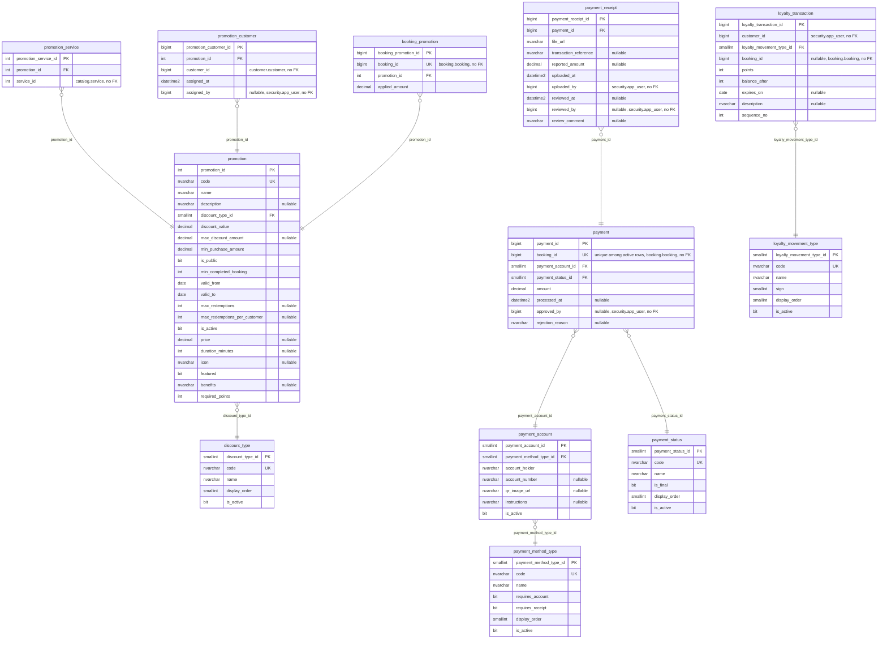

# ER — Schemas promotion and payment (payment-service, 12 tables)

Source: the Liquibase changelogs of `lavarapido-payment-service` on `origin/develop` (`16a6fac`, 2026-10-23), every changeset applied (last structural file: `021-promotion-one-per-booking.sql`). Each entity lists all its columns except the standard audit block, which is in the table under the diagram. Types are the SQL Server base type; lengths, precision and defaults are in `09-microservices/services/06-payment-service/data-model.md`. `PK`, `FK` and `UK` (unique, alone or filtered) are the database keys; "nullable" marks columns that accept NULL. One relationship per foreign key, labelled with its column.

## Audit columns

The standard block is `created_at`, `created_by`, `updated_at`, `updated_by`, `deleted_at`, `deleted_by`, `row_version` (`06-data/modeling-conventions.md`).

| Table | Audit columns |
|---|---|
| `promotion.discount_type` | all seven |
| `promotion.promotion` | all seven |
| `promotion.promotion_service` | all seven |
| `promotion.promotion_customer` | all seven |
| `promotion.booking_promotion` | all seven |
| `payment.payment_method_type` | all seven |
| `payment.payment_account` | all seven |
| `payment.payment_status` | all seven |
| `payment.payment` | all seven |
| `payment.payment_receipt` | all seven |
| `payment.loyalty_movement_type` | all seven |
| `payment.loyalty_transaction` | all seven |

## References to other services

They have no foreign key (ADR-003); the code keeps them consistent.

| Column | Points to | Owner |
|---|---|---|
| `promotion.promotion_service.service_id` | `catalog.service` | booking-service |
| `promotion.promotion_customer.customer_id` | `customer.customer` | customer-service |
| `promotion.promotion_customer.assigned_by` | `security.app_user` | security-service |
| `promotion.booking_promotion.booking_id` | `booking.booking` | booking-service |
| `payment.payment.booking_id` | `booking.booking` | booking-service |
| `payment.payment.approved_by` | `security.app_user` | security-service |
| `payment.payment_receipt.uploaded_by` | `security.app_user` | security-service |
| `payment.payment_receipt.reviewed_by` | `security.app_user` | security-service |
| `payment.loyalty_transaction.customer_id` | `security.app_user` (the client's user id, ADR-015) | security-service |
| `payment.loyalty_transaction.booking_id` | `booking.booking` | booking-service |
