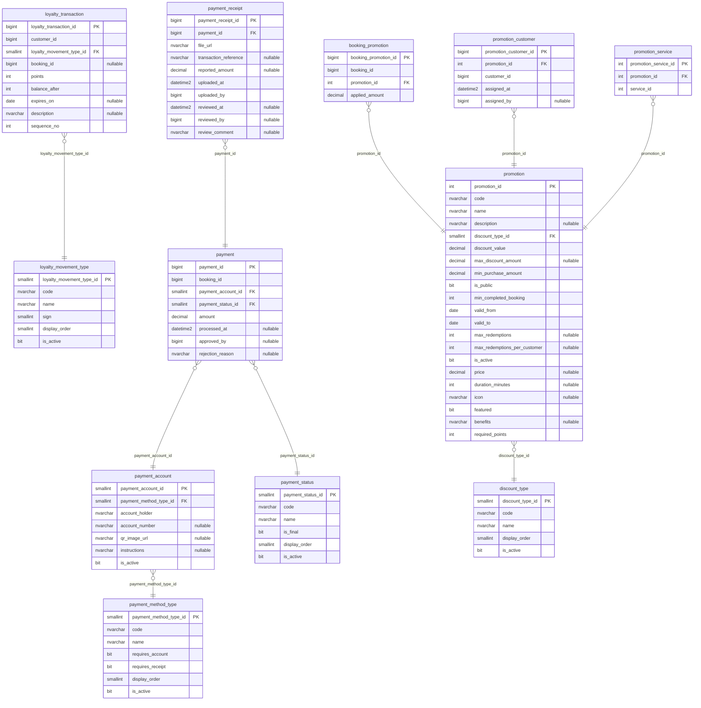

# ER — Schemas promotion and payment (payment-service, 12 tables)

Source: the `LavaRapido` database read on 2026-10-19 (`sys.tables`, `sys.columns`, `sys.foreign_keys`) with every
migration applied (up to 039). The audit block (`created_at`, `created_by`, `updated_at`, `updated_by`,
`deleted_at`, `deleted_by`, `row_version`) is left out to keep the diagram readable; 12 of the 12 tables have some or all of these columns.

References to other services have no foreign key (ADR-003); they are kept by the code:

| Column | Points to | Owner |
|---|---|---|
| `payment.loyalty_transaction.customer_id` | `security.app_user` (holds the user id of the customer; the column keeps its first name) | security-service |
| `payment.loyalty_transaction.booking_id` | `booking.booking` | booking-service |
| `payment.payment.booking_id` | `booking.booking` | booking-service |
| `payment.payment.approved_by` | `security.app_user` | security-service |
| `payment.payment_receipt.uploaded_by` | `security.app_user` | security-service |
| `payment.payment_receipt.reviewed_by` | `security.app_user` | security-service |
| `promotion.booking_promotion.booking_id` | `booking.booking` | booking-service |
| `promotion.promotion_customer.customer_id` | `customer.customer` (table ready; the code does not use it yet) | customer-service |
| `promotion.promotion_customer.assigned_by` | `security.app_user` | security-service |
| `promotion.promotion_service.service_id` | `catalog.service` (table ready; the code does not use it yet) | booking-service |
