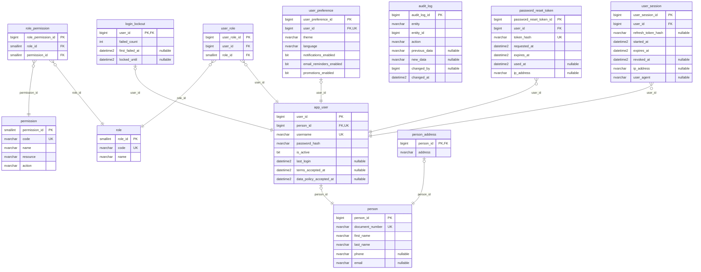

# ER — Schemas security and audit (security-service, 12 tables)

Source: the Liquibase changelogs of `security-service` on `origin/develop` (`b5fe56e`, 2026-10-24), every changeset applied (last structural file: `039-security-app-user-legal-consent.sql`). Each entity lists all its columns except the standard audit block, which is in the table under the diagram. Types are the SQL Server base type; lengths, precision and defaults are in `09-microservices/services/02-security-service/data-model.md`. `PK`, `FK` and `UK` (unique, alone or filtered) are the database keys; "nullable" marks columns that accept NULL. One relationship per foreign key, labelled with its column.

## Audit columns

The standard block is `created_at`, `created_by`, `updated_at`, `updated_by`, `deleted_at`, `deleted_by`, `row_version` (`06-data/modeling-conventions.md`).

| Table | Audit columns |
|---|---|
| `security.person` | — |
| `security.app_user` | created_at |
| `security.role` | — |
| `security.permission` | — |
| `security.role_permission` | — |
| `security.user_role` | — |
| `security.user_session` | — |
| `security.password_reset_token` | — |
| `audit.audit_log` | — |
| `security.user_preference` | all seven |
| `security.login_lockout` | updated_at |
| `security.person_address` | updated_at |

## References to other services

None: this service owns every table its columns point to.
