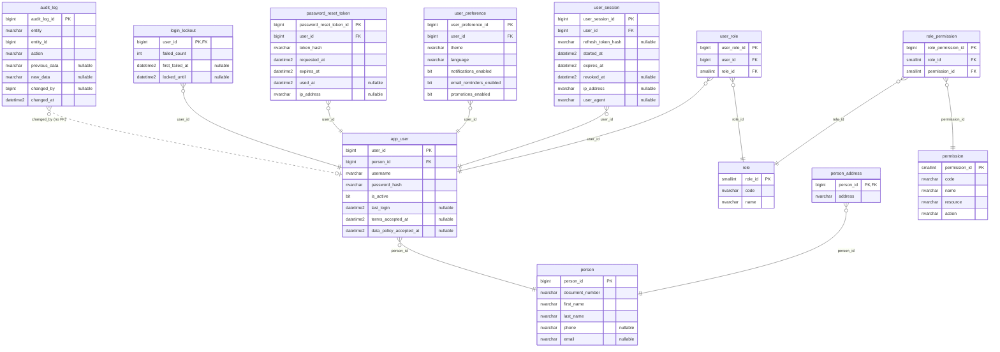

# ER — Schemas security and audit (security-service, 12 tables)

Source: the `LavaRapido` database read on 2026-10-19 (`sys.tables`, `sys.columns`, `sys.foreign_keys`) with every
migration applied (up to 039). The audit block (`created_at`, `created_by`, `updated_at`, `updated_by`,
`deleted_at`, `deleted_by`, `row_version`) is left out to keep the diagram readable; 4 of the 12 tables have it.

