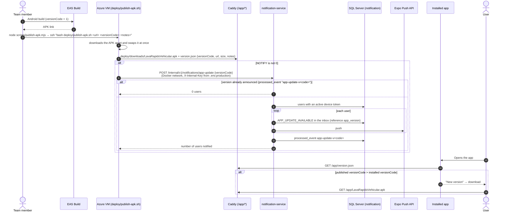

# Sequence — Publishing a new Android APK and telling the users

Source: `LavadoVehicular-Movil/scripts/publish-apk.mjs`, `lavarapido-infra/deploy/publish-apk.sh`,
`notification-service` `InternalAppUpdateController` and `AppUpdateNoticeService`, app
`AppUpdatesCheck.tsx` and `publishedApk.ts`; checked against the code on 2026-10-19.

The web download button reads the same `version.json`. The `/internal` route is never published by the
gateway or Caddy; the script calls it from inside the Docker network.
