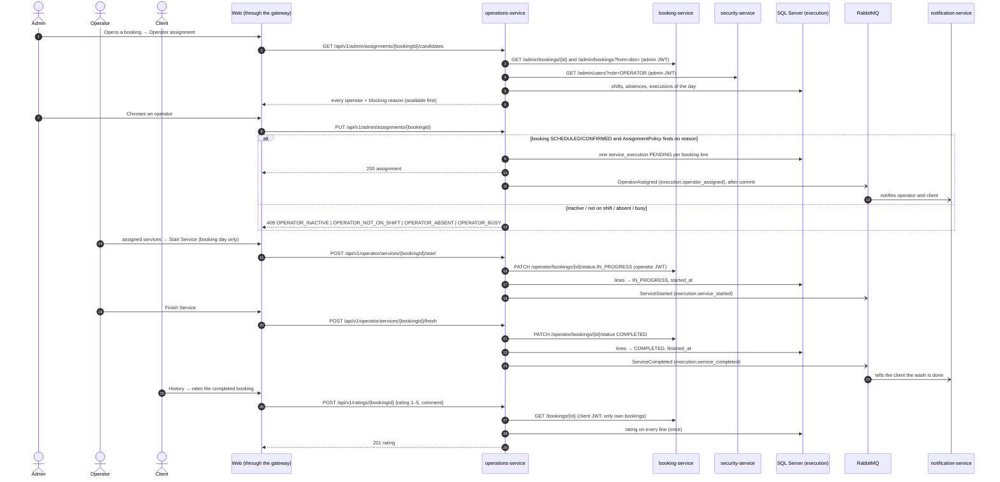

# Sequence — Operator assignment and execution (RF-009, RF-011, RF-012, RF-012b)

Source: `operations-service` `OperationsService.candidates / assign / start / finish / rate`,
`AssignmentPolicy`, `BookingServiceDirectory` (ADR-014).

Errors not drawn: 409 `SERVICE_NOT_TODAY`, `EXECUTION_ALREADY_STARTED`, `ALREADY_RATED`,
`SERVICE_NOT_COMPLETED`; 503 `BOOKING_SERVICE_UNAVAILABLE`. Paths and bodies:
`07-api/contracts/openapi/operations-service.yaml`.
