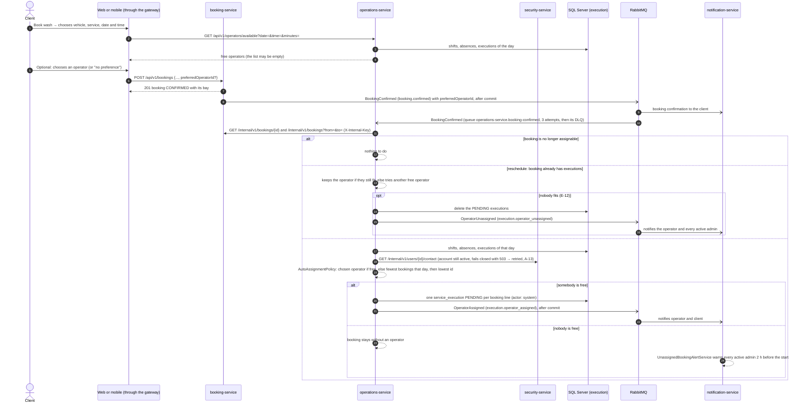

# Sequence — Automatic operator assignment (RF-008, RF-010)

Source: `booking-service` `BookingService.create`, `operations-service` `BookingConfirmedListener`,
`OperationsService.autoAssign / availableOperators`, `AutoAssignmentPolicy`, `AssignmentPolicy` (ADR-014).

The admin can still change the operator by hand with `PUT /api/v1/admin/assignments/{bookingId}`
(`seq-assignment-execution.md`). Automatic assignment can be turned off with
`app.auto-assign.enabled=false`. Paths and bodies: `07-api/contracts/openapi/operations-service.yaml`.
