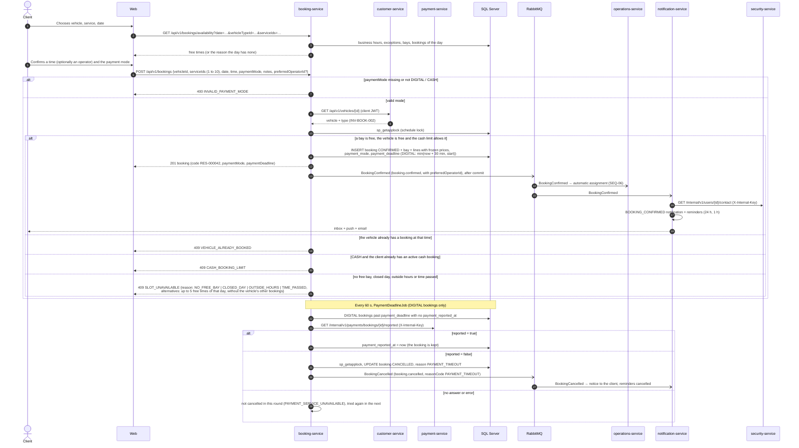

# Sequence — Book a wash (RF-005, RF-006, RF-010)

Source: `booking-service` `BookingService.availability / create / cancelForPaymentTimeout`, `AvailabilityPolicy`,
`PaymentPolicy`, `PaymentDeadlineJob`, `CustomerVehicleDirectory`, `PaymentStatusDirectory`; checked against
the code on 2026-10-19, payment at booking added on 2026-10-27 (ADR-021).

The availability call's exact parameters are in `07-api/contracts/openapi/booking-service.yaml`. The web and
the app translate `reason` into the message shown to the customer. Operator assignment after the
event: [seq-auto-assignment](./seq-auto-assignment.md). How the reported payment reaches booking
before the deadline (`payment.reported`): [seq-payment](./seq-payment.md). Admin bookings have no payment
deadline and no cash limit; a reschedule keeps the deadline.
