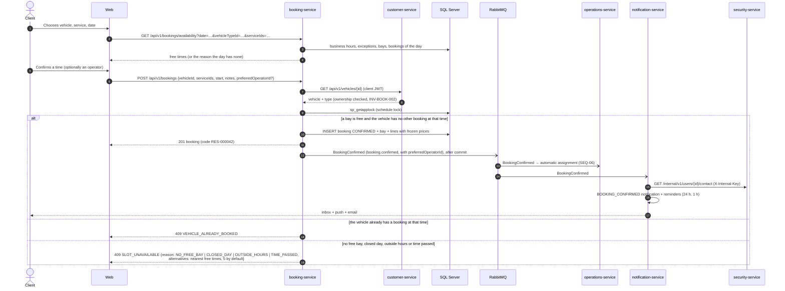

# Sequence — Book a wash (RF-005, RF-006, RF-010)

Source: `booking-service` `BookingService.availability / create`, `AvailabilityPolicy`,
`CustomerVehicleDirectory`; checked against the code on 2026-10-19.

The availability call's exact parameters are in `07-api/contracts/openapi/booking-service.yaml`. The web and
the app translate `reason` into the message shown to the customer. Operator assignment after the
event: [seq-auto-assignment](./seq-auto-assignment.md).
