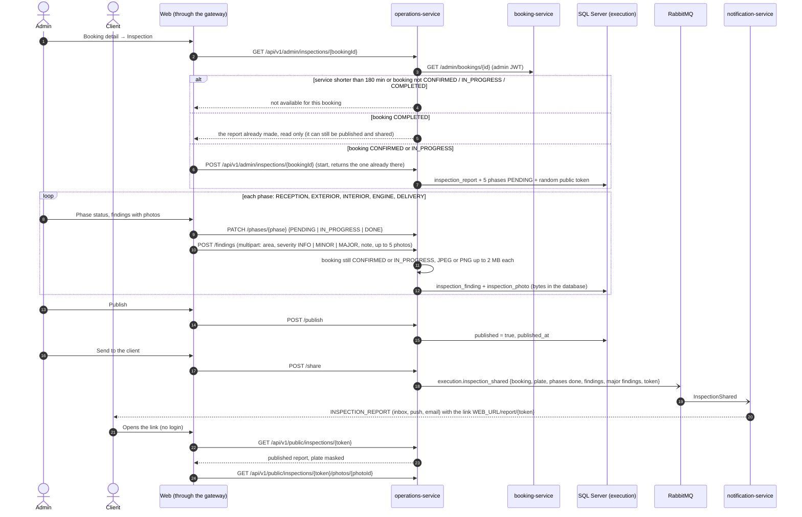

# Sequence — Vehicle inspection report (RF-030 in the SRS, CU30)

Source: `operations-service` `InspectionControllers` (`/api/v1/admin/inspections/{bookingId}`,
`/api/v1/public/inspections/{token}`), `InspectionService`, `InspectionReport`; web
`admin/reservations/:id/inspection` and the public page `report/:token`; checked against the code on
2026-10-20.

Errors not drawn: 400 `TOO_MANY_PHOTOS`, `INVALID_PHOTO`, `BOOKING_WITHOUT_CLIENT`; an unpublished
report is not served by the public route. States of the report: [state-inspection](./state-inspection.md).
