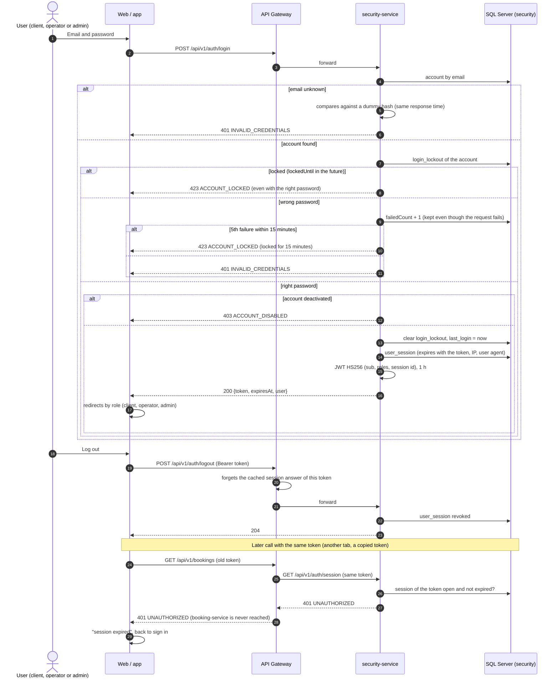

# Sequence — Login, lockout and logout (RF-002, RF-004b)

Source: `security-service` `AuthController` (`/api/v1/auth/login`, `/logout`, `/session`), `AuthenticationService.login /
logout / isActive`, `LoginLockout`, `JwtTokenIssuer`, `ActiveSessionValidator`; gateway `SessionCheckFilter`; checked
against the code on 2026-10-21.

The gateway keeps each answer of `/api/v1/auth/session` for 30 seconds per token, so an open session
costs one extra call every half minute, not one per request. A session also closes when an
administrator disables the account or the owner closes it; those reach the other services within the
same 30 seconds (ADR-006, update 2026-10-21).

The deactivated state is checked only after the password, so only the owner of the account learns it
is disabled. Recovering the password also clears the lockout ([seq-password-recovery](./seq-password-recovery.md)).
