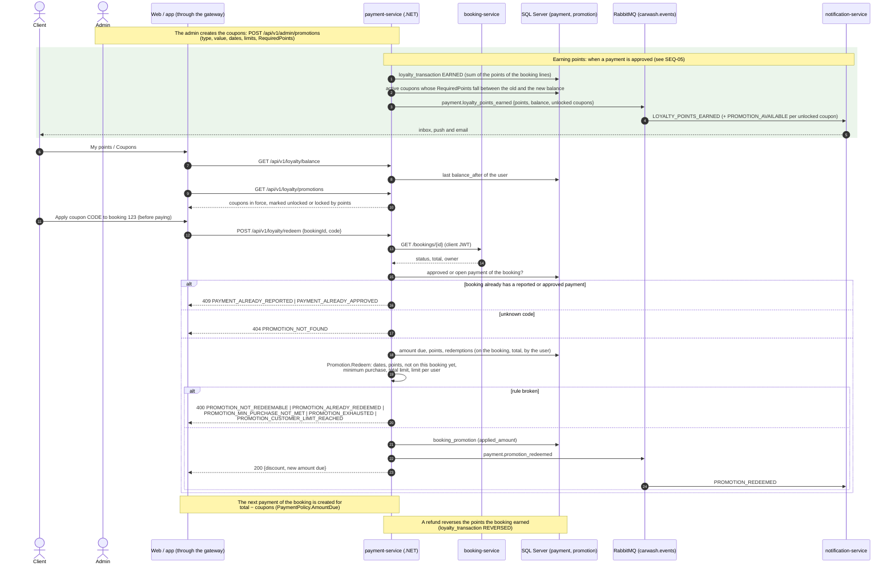

# Sequence — Loyalty points and coupon redemption (RF-024, RF-025, RF-026)

Source: `payment-service` `LoyaltyController` (`/api/v1/loyalty`), `CustomerPromotionService.RedeemAsync`,
`LoyaltyService.BalanceAsync`, `LoyaltyRewardService`, `Promotion.Redeem`, `AmountDueCalculator`.
Checked against the code on 2026-10-19.

Points are not spent when a coupon is used: `RequiredPoints` is the level that unlocks it, and the
balance keeps growing with each paid booking. Ledger rules: [class-payment](./class-payment.md).
