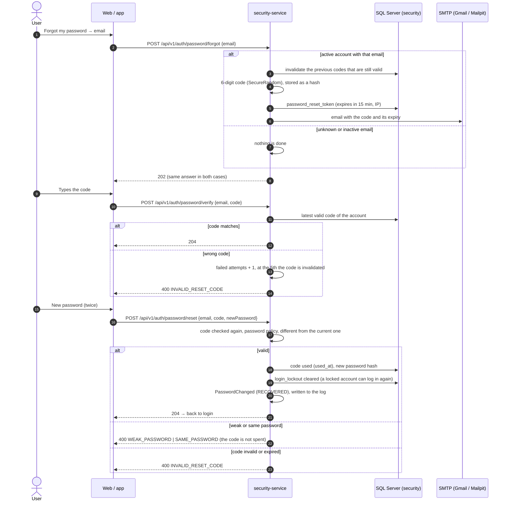

# Sequence — Password recovery with a 6-digit code (RF-003)

Source: `security-service` `AuthController` (`/api/v1/auth/password/forgot | verify | reset`),
`PasswordRecoveryService`, `PasswordResetToken`, `PasswordRecoveryPolicy` (`code-ttl: 15m`,
`max-failed-attempts: 5`), `SecureRandomResetCodeGenerator`, `EmailResetCodeNotifier`; checked
against the code on 2026-10-19.

The answer of `forgot` does not reveal whether the email exists. The failed-attempt counter lives in
memory (`InMemoryResetAttemptCounter`); the code itself, its hash and its expiry live in the database.
