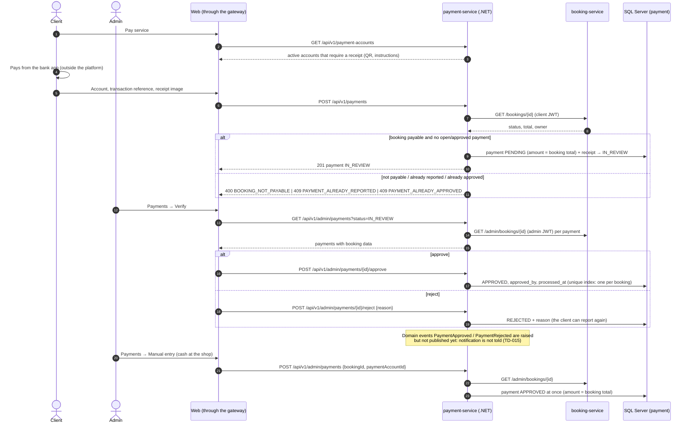

# Sequence — Payment by receipt and review (RF-013, RF-013b, RF-014)

Source: `payment-service` `PaymentCommandService.ReportAsync / ApproveAsync / RejectAsync /
RegisterInPersonAsync` (input port `IPaymentCommandUseCases`), `Payment` aggregate,
`BookingServiceDirectory` (ADR-008, ADR-013).

Paths and bodies: `07-api/contracts/openapi/payment-service.yaml`.
