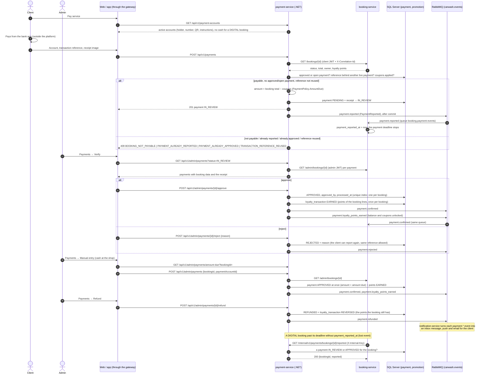

# Sequence — Payment by receipt, review, manual payment and refund (RF-013, RF-013b, RF-014, RF-016)

Source: `payment-service` `PaymentCommandService.ReportAsync / ApproveAsync / RejectAsync /
RegisterInPersonAsync / RefundAsync` (input port `IPaymentCommandUseCases`), `BookingPaymentGuard`,
`AmountDueCalculator`, `LoyaltyRewardService`, `Payment` aggregate, `BookingServiceDirectory`
(ADR-008, ADR-013); booking-service `PaymentEventsListener` and `PaymentDeadlineJob`, payment-service
`InternalPaymentsController` (ADR-021). Checked against the code on 2026-10-19, `payment.reported` and the
internal check added on 2026-10-27.

The coupon applied before paying is in [seq-loyalty-coupon](./seq-loyalty-coupon.md). What booking does
with the answer of the internal check (keep the booking or cancel it with `PAYMENT_TIMEOUT`) is in
[seq-booking](./seq-booking.md). booking also takes `payment.confirmed` from the same queue and sets
`payment_reported_at` if it was still empty. Paths and bodies: `07-api/contracts/openapi/payment-service.yaml`.
