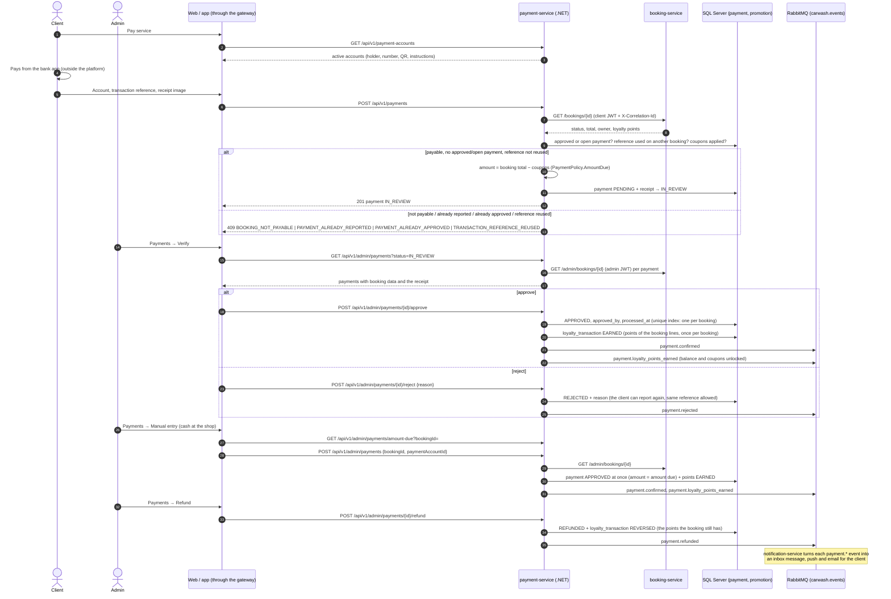

# Sequence — Payment by receipt, review, manual payment and refund (RF-013, RF-013b, RF-014, RF-016)

Source: `payment-service` `PaymentCommandService.ReportAsync / ApproveAsync / RejectAsync /
RegisterInPersonAsync / RefundAsync` (input port `IPaymentCommandUseCases`), `BookingPaymentGuard`,
`AmountDueCalculator`, `LoyaltyRewardService`, `Payment` aggregate, `BookingServiceDirectory`
(ADR-008, ADR-013). Checked against the code on 2026-10-19.

The coupon applied before paying is in [seq-loyalty-coupon](./seq-loyalty-coupon.md). Paths and
bodies: `07-api/contracts/openapi/payment-service.yaml`.
