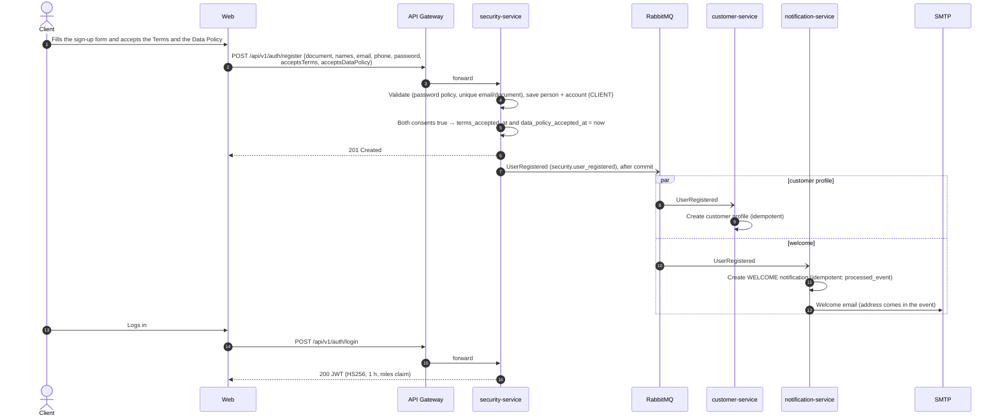

# Sequence — Sign-up and welcome (RF-001, RF-018)

Source: `security-service` `AuthController.register`, `AccountRegistrationService`,
`RabbitDomainEventPublisher`; checked against the code on 2026-10-19.

A failure in a consumer is retried and then sent to its dead-letter queue
(`customer-service.events.dlq`, `notification-service.events.dlq`); the sign-up itself is
already committed.

The two consent fields are optional in the API so that older app versions keep working; the current
web and app send them, and the account stores when they were accepted.
