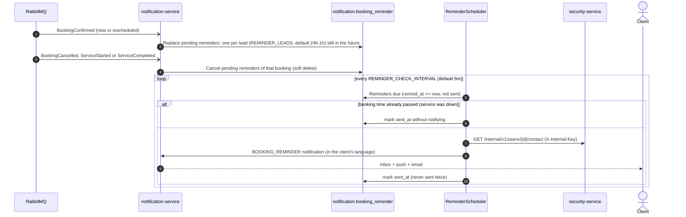

# Sequence — Booking reminder (ADR-011 §7)

Source: `notification-service` `DomainEventConsumerService.updateReminders`, `BookingReminderService`,
`BookingReminder`; checked against the code on 2026-10-19.

