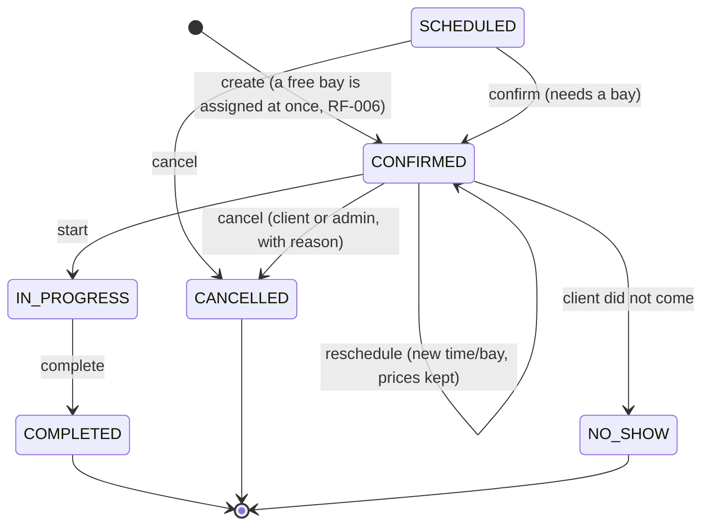

# State — Booking lifecycle (RF-006, RF-007)

Source: `booking-service` `Booking.moveTo`, `Booking.cancel`, `BookingStatus`.

| Rule | Where |
|---|---|
| Only `SCHEDULED` and `CONFIRMED` can be changed or cancelled (RF-007) | `BookingStatus.isChangeable()` |
| `SCHEDULED`, `CONFIRMED`, `IN_PROGRESS` occupy the bay | `BookingStatus.occupiesBay()`, trigger `tr_booking_bay_overlap` |
| `SCHEDULED` exists in the model (status id 1) but the current flow never creates it | `Booking.confirmNew` |
