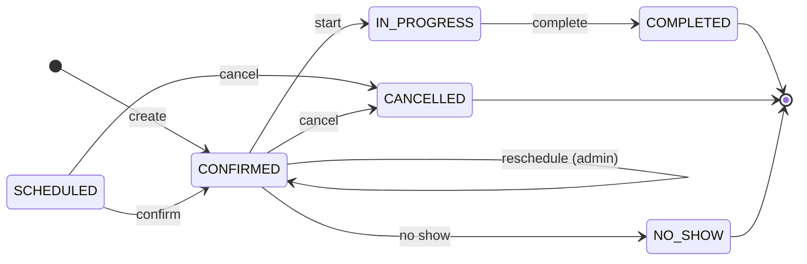

# State — Booking lifecycle (RF-006, RF-007)

Source: `booking-service` `Booking.moveTo`, `Booking.cancel`, `Booking.reschedule`, `BookingStatus`.
Checked on 2026-10-20.

| Rule | Where |
|---|---|
| `create` confirms the booking at once with a free bay (RF-006) | `Booking.confirmNew` |
| `reschedule` changes time, bay and lines; the admin does it (CU29). The API also accepts it from the client before the start (`PUT /api/v1/bookings/{id}`), but the web and the app do not offer it | `Booking.reschedule`, `BookingService.reschedule` |
| `cancel` always stores a reason: the client cancels before the start without giving one (`CUSTOMER_REQUEST`); the admin may pick one from `cancellation_reason` (`CUSTOMER_REQUEST` if none is sent) | `Booking.cancel`, `BookingService.cancel` |
| `start` and `complete` happen when the operator starts and finishes the service; `no show` when the client did not come | `Booking.moveTo` |
| Only `SCHEDULED` and `CONFIRMED` can be changed or cancelled (RF-007); the client, only before the start time | `BookingStatus.isChangeable()`, `Booking.changeableByCustomer` |
| `SCHEDULED`, `CONFIRMED`, `IN_PROGRESS` occupy the bay | `BookingStatus.occupiesBay()`, trigger `tr_booking_bay_overlap` |
| Any other move → 409 `INVALID_STATUS_TRANSITION` | `Booking.moveTo` |
| `SCHEDULED` exists in the model (status id 1) but the current flow never creates it | `Booking.confirmNew` |
