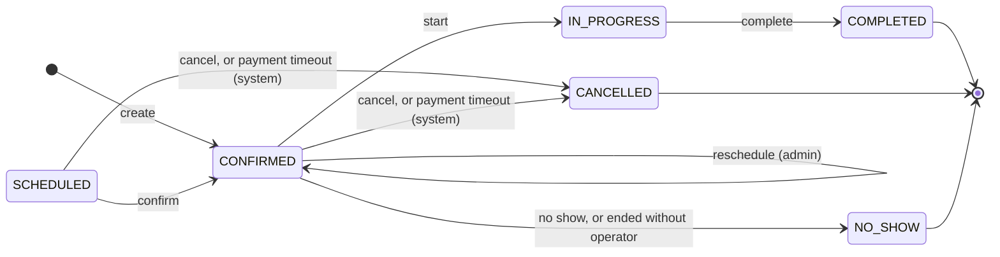

# State — Booking lifecycle (RF-006, RF-007)

Source: `booking-service` `Booking.moveTo`, `Booking.cancel`, `Booking.reschedule`,
`Booking.markUnattended`, `BookingStatus`; `operations-service` `FollowUpPolicy`, `FollowUpService`.
Checked on 2026-10-21; events and the look-back window checked against `origin/develop` on 2026-10-23;
the expiry job removed and the client reschedule rule checked on 2026-10-24; payment timeout added on 2026-10-26 (also from `SCHEDULED`, 2026-10-27).

| Rule | Where |
|---|---|
| `create` confirms the booking at once with a free bay (RF-006) | `Booking.confirmNew` |
| `reschedule` changes time, bay and lines; the admin does it (CU29). The API also accepts it from the client before the start (`PUT /api/v1/bookings/{id}`), only for date and time (other services → 409 `BOOKING_SERVICES_LOCKED`, BIZ-01), but the web and the app do not offer it. A stale `row_version` answers 409 `CONFLICT` (BIZ-09) | `Booking.reschedule`, `BookingService.reschedule` |
| `cancel` always stores a reason: the client cancels before the start without giving one (`CUSTOMER_REQUEST`); the admin may pick one from `cancellation_reason` (`CUSTOMER_REQUEST` if none is sent) | `Booking.cancel`, `BookingService.cancel` |
| `start` and `complete` happen when the operator starts and finishes the service; `no show` when the client did not come | `Booking.moveTo` |
| Only `SCHEDULED` and `CONFIRMED` can be changed or cancelled (RF-007); the client, only before the start time | `BookingStatus.isChangeable()`, `Booking.changeableByCustomer` |
| `SCHEDULED`, `CONFIRMED`, `IN_PROGRESS` occupy the bay | `BookingStatus.occupiesBay()`, trigger `tr_booking_bay_overlap` |
| `ended without operator`: a `CONFIRMED` booking that never had an operator and is still open one hour after its end becomes `NO_SHOW` by itself: nobody could have attended it. operations-service decides (it knows the assignments) and booking checks the margin again | `FollowUpService.followUp`, `Booking.markUnattended` (`POST /internal/v1/bookings/{id}/no-show`) |
| A `CONFIRMED` booking **with** an operator is never closed by itself: the operator may have attended and forgotten to press Start. Once its time ends it goes to the admin's **To close** list (also an `IN_PROGRESS` one nobody finished, one hour after its end), and the operator and the admins get a notice. The admin picks **Attended** (`COMPLETED`, through `IN_PROGRESS`) or **No-show** | `FollowUpPolicy`, `POST /api/v1/admin/assignments/{id}/attended`, `PATCH /api/v1/admin/bookings/{id}/status` |
| The follow-up job and the **To close** list look back `FOLLOW_UP_LOOK_BACK_DAYS` (28) days | `FollowUpService` |
| Every change publishes an event: create, reschedule or back to confirmed → `booking.confirmed`; cancel → `booking.cancelled` (with `reasonCode`); the admin's start, complete or no-show → `booking.status_changed` (A-11); the operator's start and finish are announced by operations (`execution.*`) | `BookingService`, `BookingEvent` |
| `payment timeout`: a client's DIGITAL booking (`SCHEDULED` or `CONFIRMED`) whose `payment_deadline` passed without a reported payment is cancelled by the system with `PAYMENT_TIMEOUT`, only after payment-service says there is no payment in review or approved; if payment-service does not answer it waits for the next round (ADR-021, INV-BOOK-012) | `PaymentDeadlineJob`, `BookingService.cancelForPaymentTimeout`, `Booking.paymentOverdue` |
| Any other move → 409 `INVALID_STATUS_TRANSITION` | `Booking.moveTo` |
| booking's own expiry job (`ExpiredBookingsJob`, `closeExpired`, `Booking.expire`) was removed on 2026-10-24 (B-07): the current flow never creates `SCHEDULED`, and operations closes the no-shows | booking `c9860e4` |
| `SCHEDULED` exists in the model (status id 1) but the current flow never creates it | `Booking.confirmNew` |
