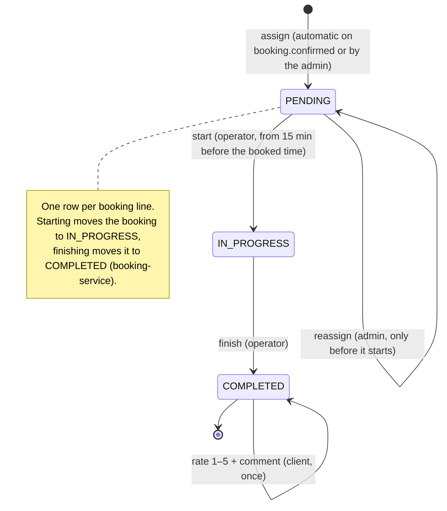

# State — Service execution (RF-009, RF-012, RF-012b)

Source: `operations-service` `ServiceExecution` (`assign`, `reassign`, `start`, `finish`, `rate`),
`ExecutionStatus`, `StartPolicy`; seed `execution.execution_status`. Checked on 2026-10-19.

| Rule | Where |
|---|---|
| `reassign` and `start` only from `PENDING`, else 409 `EXECUTION_ALREADY_STARTED` | `ServiceExecution` |
| `finish` only from `IN_PROGRESS`, else 409 `EXECUTION_NOT_STARTED` | `ServiceExecution.finish` |
| Starting earlier than 15 minutes before the booking → 409 `SERVICE_TOO_EARLY` | `StartPolicy.check` |
| Rating only when `COMPLETED`, once, 1 to 5 stars | `ServiceExecution.rate` |
| `execution.service_started` and `execution.service_completed` are published; the client is told and the reminders are cancelled | `OperationsService`, notification-service |

`PAUSED` (3) and `WITH_ISSUE` (5) exist in `execution.execution_status` and in the enum for a later
version; no use case moves an execution to them today.
