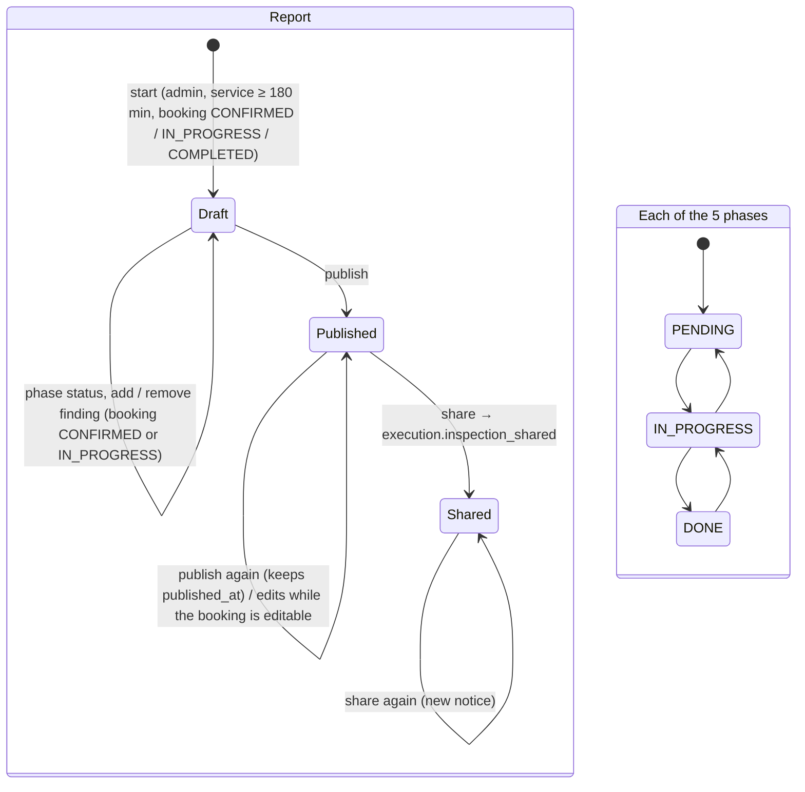

# State — Inspection report and its phases (CU30)

Source: `operations-service` `InspectionReport` (`start`, `setPhaseStatus`, `addFinding`,
`removeFinding`, `publish`, `requirePublished`), `InspectionPhaseStatus`. Checked on 2026-10-19.

| Rule | Where |
|---|---|
| Phases: `RECEPTION`, `EXTERIOR`, `INTERIOR`, `ENGINE`, `DELIVERY`; the admin sets any status | `InspectionReport.setPhaseStatus` |
| Editing needs the booking `CONFIRMED` or `IN_PROGRESS`, else 409 `INSPECTION_NOT_EDITABLE` | `InspectionReport.requireEditable` |
| A finding has up to 5 photos (JPEG or PNG, 2 MB each) | `InspectionReport.addFinding`, `InspectionService` |
| Sharing an unpublished report → 409 `INSPECTION_NOT_PUBLISHED`; a booking without a client account → 400 `BOOKING_WITHOUT_CLIENT` | `requirePublished`, `InspectionService.share` |
| Only a published report is served by `/api/v1/public/inspections/{token}` | `InspectionService.published` |

"Shared" is not stored as a column: it is the moment the event is sent, and it can be repeated.
