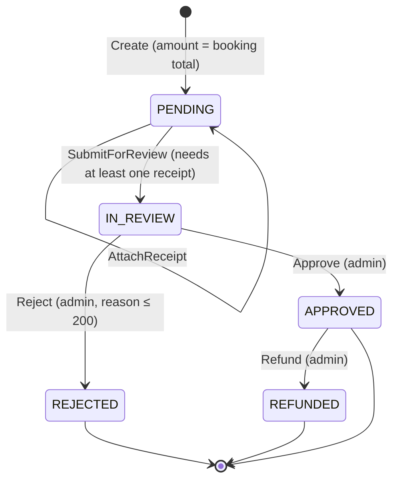

# State — Payment lifecycle (RF-013b, RF-014, ADR-008)

Source: `payment-service` `Payment` aggregate (`SubmitForReview`, `Approve`, `Reject`, `Refund`),
`PaymentStatus`, seed `payment.payment_status`.

| Rule | Where |
|---|---|
| A client payment goes `PENDING → IN_REVIEW` in the same request; a manual payment goes straight to `APPROVED` | `PaymentApplicationService` |
| One approved payment per booking (`APPROVED` must be id 3) | `ux_payment_one_approved_per_booking` + use-case check |
| One open (`PENDING` / `IN_REVIEW`) payment per booking | `HasOpenPaymentAsync` → 409 `PAYMENT_ALREADY_REPORTED` |
| After `REJECTED` the client can report a new payment for the same booking | No open payment remains |
| Any other transition throws `DomainException` | `Payment.EnsureStatus` |
